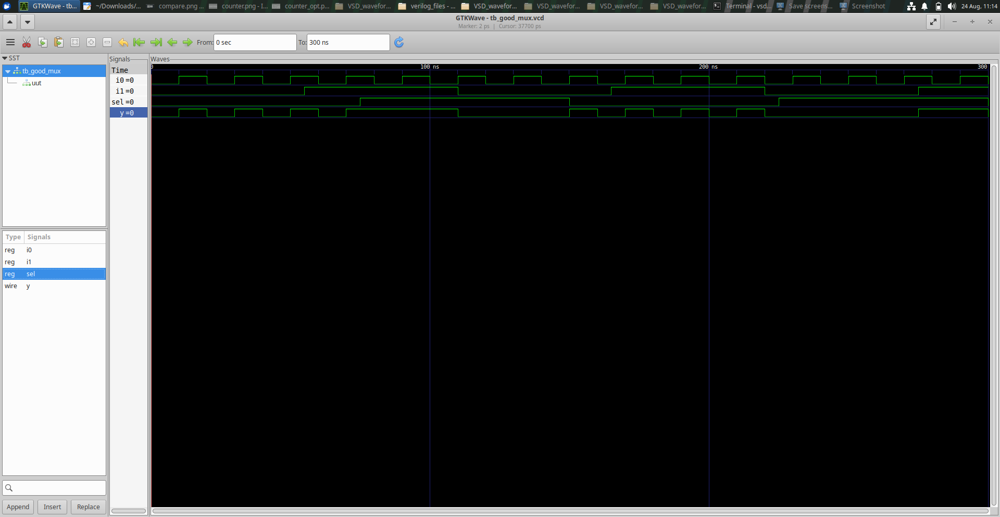
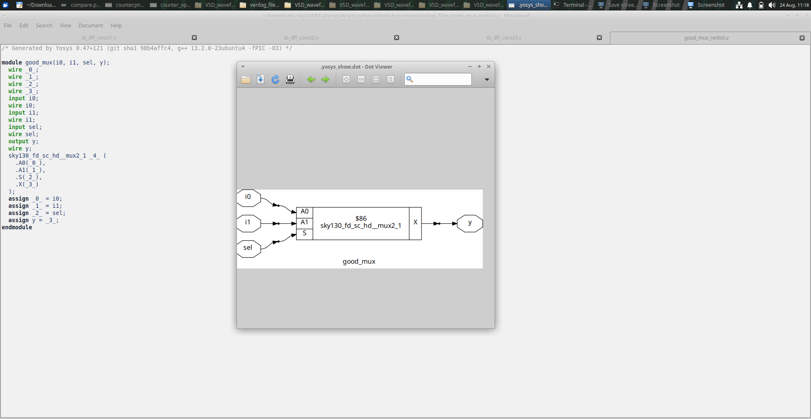

# Module 1 — RTL Design & Simulation

## 1. Module Overview

Module 1 introduces the fundamental RTL development cycle using a **2:1 multiplexer (`good_mux`)**.

The experiment is intentionally simple so that the relationship between specification, RTL, simulation and synthesized hardware can be studied without the complexity of a large design.

The module establishes the basic workflow used throughout the remaining workshop:

```text
Design Requirement
      ↓
RTL Description
      ↓
Simulation / Verification
      ↓
Synthesis
      ↓
Hardware Representation
```

---

## 2. Learning Objectives

By the end of this module, the experiment should make the following ideas clear:

- RTL describes hardware behavior and structure.
- A combinational circuit has an output determined by its current inputs.
- A multiplexer selects one of several inputs according to a control signal.
- RTL simulation is used to verify functional intent.
- Synthesis converts RTL into a structural hardware representation.
- The synthesized netlist can be inspected to understand the hardware inferred from RTL.

---

# Experiment 1 — 2:1 Good MUX

## Objective

Design and study a simple 2:1 multiplexer and follow it from RTL description to synthesized hardware.

The main goals are to understand:

1. MUX selection behavior.
2. Combinational RTL.
3. Functional verification.
4. RTL-to-netlist transformation.

---

## Concept

A 2:1 MUX has two data inputs, one select signal and one output.

```text
             ┌─────────────┐
 D0 ────────►│             │
 D1 ────────►│    2:1 MUX  │────► Y
 S  ────────►│             │
             └─────────────┘
```

The select signal determines which input reaches the output:

```text
S = 0  →  Y = D0
S = 1  →  Y = D1
```

The same relationship can be represented by the conditional expression:

```text
Y = S ? D1 : D0
```

This is an important RTL concept: a high-level expression can describe a hardware selection function.

---

## RTL / Design Figure



The figure represents the `good_mux` implementation used in the workshop.

### What to Observe

- The two data paths entering the MUX.
- The select/control path.
- The single output produced by the selection logic.
- The fact that no storage element is required for the basic MUX function.

Because the MUX is combinational, the output should respond to changes in its inputs without requiring a clock.

---

## Synthesized Netlist



The synthesized view is the structural interpretation of the RTL.

This is important because RTL syntax does not itself determine the final physical implementation. Synthesis analyzes the function and represents it using available logic structures/cells.

### What to Compare

Compare the RTL representation with the netlist and ask:

- Is the required selection function still present?
- Is the output driven by combinational logic?
- Has the logical behavior been preserved?
- What hardware structures are used to implement the selection?

---

## Simulation Perspective

The expected simulation behavior is straightforward:

| Select | Output |
|---|---|
| `0` | First data input |
| `1` | Second data input |

A testbench can apply different combinations of the data and select inputs and verify that the output follows the selected input.

---

## Why This Experiment Matters

The MUX experiment is the starting point for later optimization experiments.

Later modules intentionally introduce coding styles that may be incomplete, ambiguous or synthesis-sensitive. Having a clean MUX implementation as a baseline makes it easier to recognize when an RTL description is no longer clearly representing the intended combinational hardware.

---

## Key Learning

- RTL is a description of hardware.
- Combinational logic does not require state storage.
- A MUX is fundamentally a selection circuit.
- Simulation verifies functional behavior.
- Synthesis reveals the structural implementation inferred from the RTL.
- A good RTL description should make the intended hardware easy to understand.

---

## Module 1 Takeaway

Module 1 establishes the core habit used throughout the workshop:

> **Describe the hardware clearly, verify the behavior, synthesize it, and inspect what hardware was actually inferred.**
