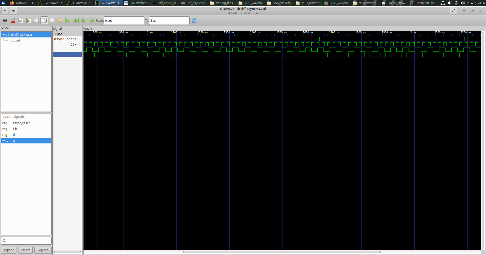
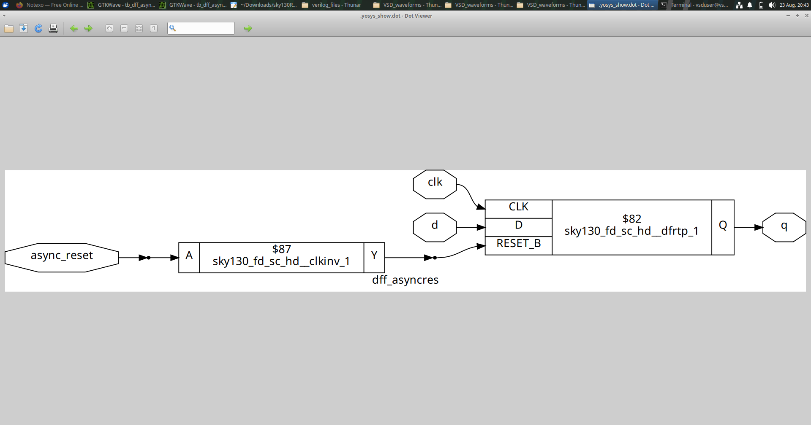
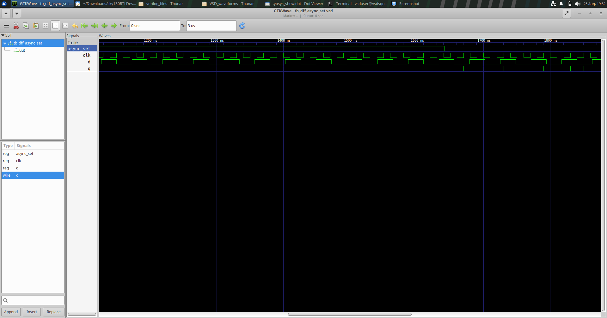
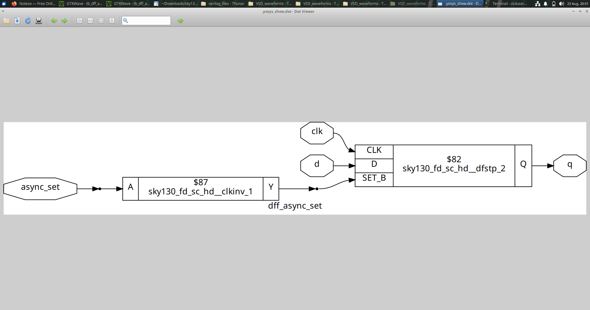
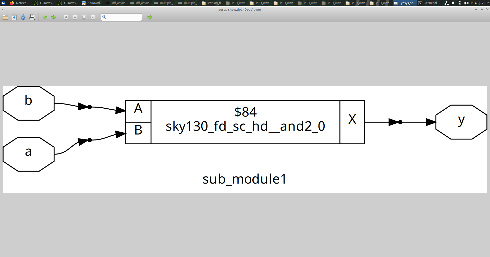
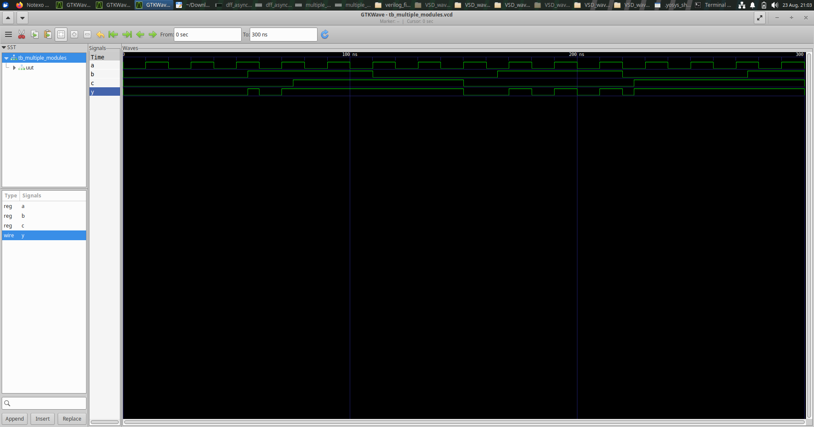
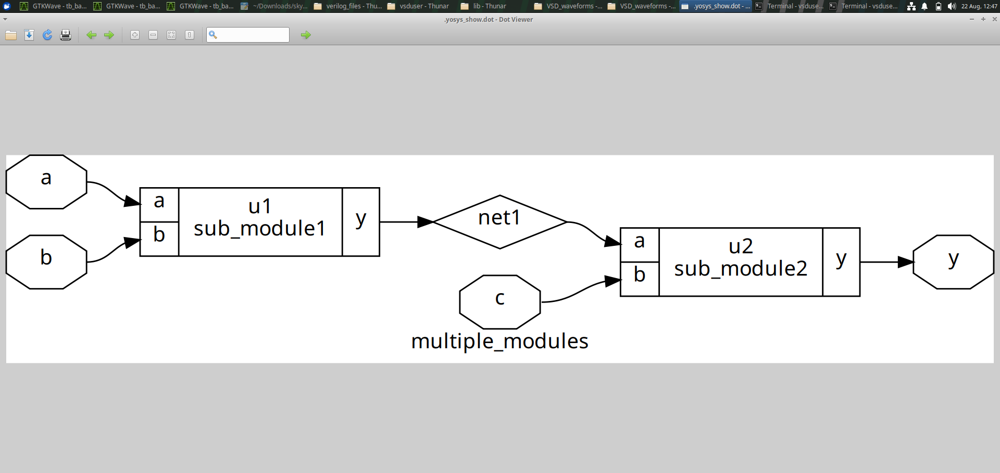
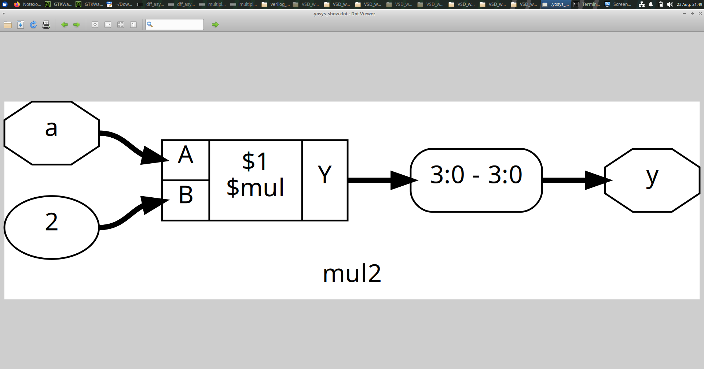
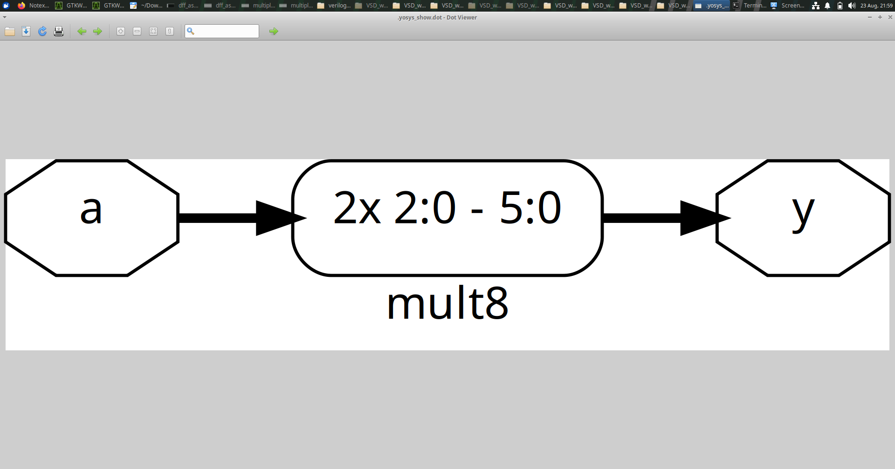

# Module 2 — Sequential Logic & RTL Synthesis

## 1. Module Overview

Module 2 moves from purely combinational logic toward **sequential hardware and synthesis**.

The experiments study:

- D flip-flops with asynchronous reset/set,
- hierarchical RTL,
- multiple-module synthesis,
- multiplier inference,
- and the relationship between RTL intent and synthesized hardware.

The central idea is that sequential RTL describes **state**. Unlike a basic combinational MUX, a flip-flop retains information and changes its state according to clock and control behavior.

---

## 2. Learning Objectives

This module develops an understanding of:

- how D flip-flops represent stored state,
- how asynchronous controls affect storage elements,
- how synthesis maps sequential RTL,
- why hierarchy is useful in RTL design,
- how arithmetic operators become hardware,
- and how synthesized structures help validate RTL intent.

---

# Experiment 1 — D Flip-Flop with Asynchronous Reset

## Objective

Study a D flip-flop whose state can be forced to a known condition through an asynchronous reset.

## Concept

A D flip-flop normally captures the input `D` on an active clock edge.

```text
             ┌───────┐
D ──────────►│  DFF  │────► Q
CLK ────────►│       │
RESET ──────►│ ARST  │
             └───────┘
```

The asynchronous reset is different from an ordinary synchronous control because its effect is associated with the reset condition rather than waiting for the normal data-capture clock event.

This distinction is important when writing sequential RTL because the sensitivity/control description communicates the intended hardware behavior.

## RTL / Synthesis Result





## What to Observe

The synthesized representation should be read as a hardware structure rather than as source-code syntax.

Look for:

- the state-holding element,
- the clock connection,
- the data connection,
- the asynchronous reset path,
- and the registered output.

## Learning

The experiment demonstrates that an asynchronous control can influence the type of sequential cell that synthesis must infer.

---

# Experiment 2 — D Flip-Flop with Asynchronous Set

## Objective

Study the complementary concept of an asynchronous set.

## Concept

An asynchronous set forces the stored state to the asserted state independently of ordinary clocked data transfer.

The important conceptual comparison is:

```text
Asynchronous Reset → forces the state to reset condition
Asynchronous Set   → forces the state to set condition
```

## Figures





## Observation

The RTL describes a sequential element with an additional asynchronous control. Synthesis therefore needs a storage structure capable of representing that behavior.

## Learning

Set and reset are not merely names in RTL; they communicate different hardware control requirements.

---

# Experiment 3 — Hierarchical / Multiple-Module RTL

## Objective

Understand how a larger RTL design can be divided into smaller modules and how those modules are connected.

## Concept

Hierarchical design organizes a system as a collection of submodules:

```text
                    TOP MODULE
                        │
          ┌─────────────┴─────────────┐
          ↓                           ↓
   SUB-MODULE 1                 SUB-MODULE 2
          │                           │
          └─────────────┬─────────────┘
                        ↓
                    TOP OUTPUT
```

This approach allows individual blocks to have their own functionality while a top-level module establishes their connectivity.

## Figures







## What to Study

Compare the RTL hierarchy with the synthesized representation.

Ask:

- Which module is the top level?
- Which blocks are submodules?
- How are signals passed between modules?
- Does the synthesized structure preserve the intended connectivity?
- Which parts of the hierarchy are visible after synthesis?

## Why Hierarchy Matters

Hierarchical RTL is useful for:

- design organization,
- reuse,
- verification,
- partitioning large systems,
- and understanding block-level connectivity.

The experiment therefore introduces an important real-world design practice: complex hardware is normally built from smaller blocks rather than one monolithic RTL description.

---

# Experiment 4 — 2-bit Multiplier

## Objective

Understand how a small arithmetic operation is translated from RTL into combinational hardware.

## Concept

A multiplier produces a product from two operands.

```text
A ─────┐
       │
       ▼
    MULTIPLIER ───► PRODUCT
       ▲
       │
B ─────┘
```

When multiplication is written at RTL, synthesis does not execute the operation like software. It derives hardware capable of producing the required product.

## Figure



## What to Observe

The experiment is useful for connecting:

```text
Arithmetic description
        ↓
RTL inference
        ↓
Combinational implementation
```

The resulting hardware complexity depends on the operand size and the implementation available to synthesis.

---

# Experiment 5 — Larger Multiplier

## Objective

Observe the hardware implications of increasing the multiplier size.



## Concept

A larger operand width generally requires more arithmetic resources than a small multiplier.

This experiment therefore introduces an important hardware-design consideration:

> Arithmetic operators are convenient at RTL, but the resulting hardware cost still matters.

## Learning

When designing hardware, functionality and implementation cost must be considered together.

---

# Module 2 — Overall Learning

The experiments demonstrate several important transitions:

```text
Combinational RTL
      ↓
Sequential RTL
      ↓
Asynchronous Controls
      ↓
Hierarchical RTL
      ↓
Arithmetic RTL
      ↓
Synthesized Hardware
```

## Key Takeaways

- Flip-flops represent state.
- Asynchronous controls affect sequential-cell requirements.
- Hierarchy makes RTL modular and reusable.
- Arithmetic operators are converted into hardware.
- Netlist inspection provides a structural view of synthesis.

## Module 2 Takeaway

Module 2 builds the bridge between **RTL descriptions and synthesized sequential/structural hardware**.
