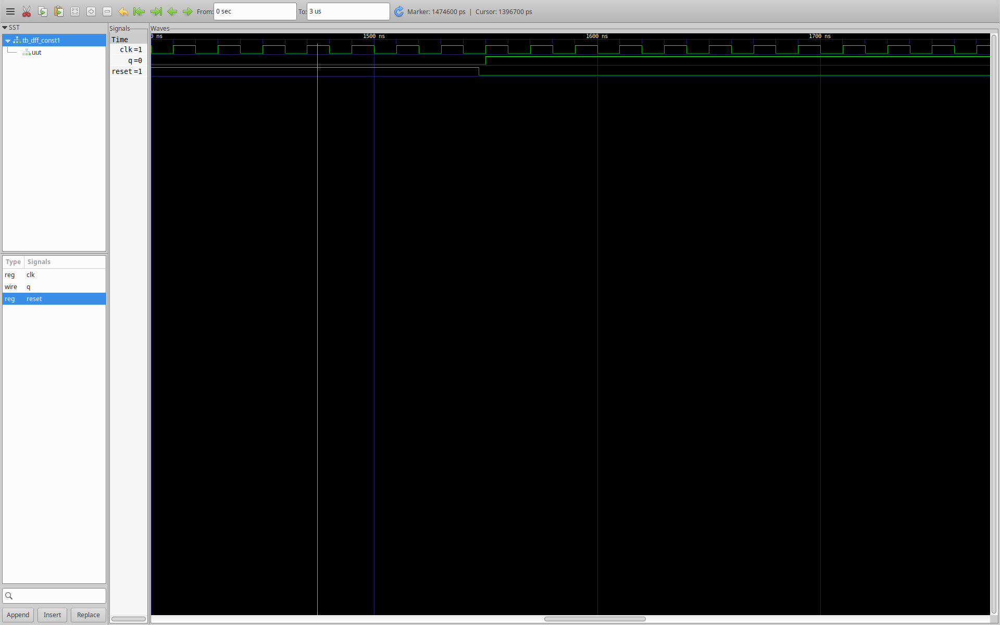
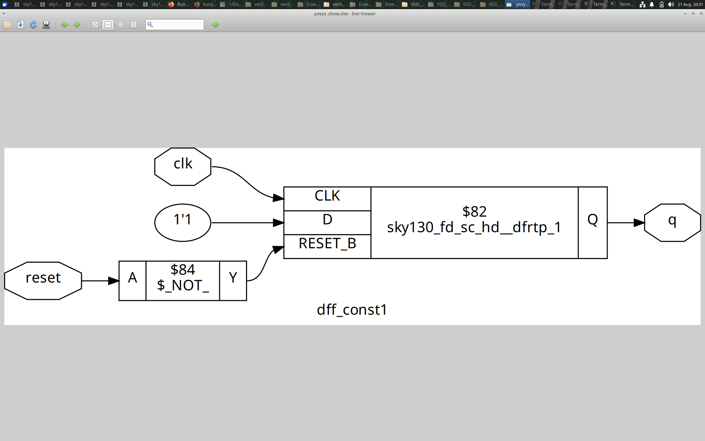
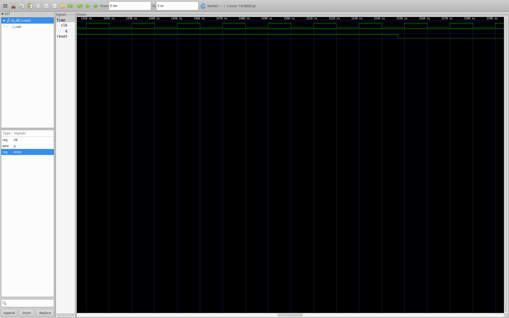
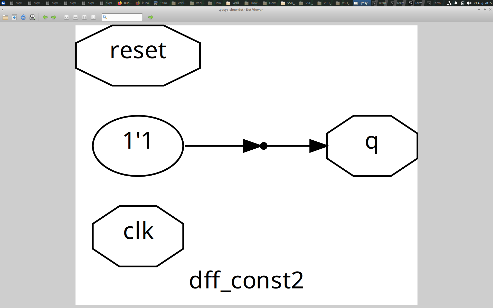
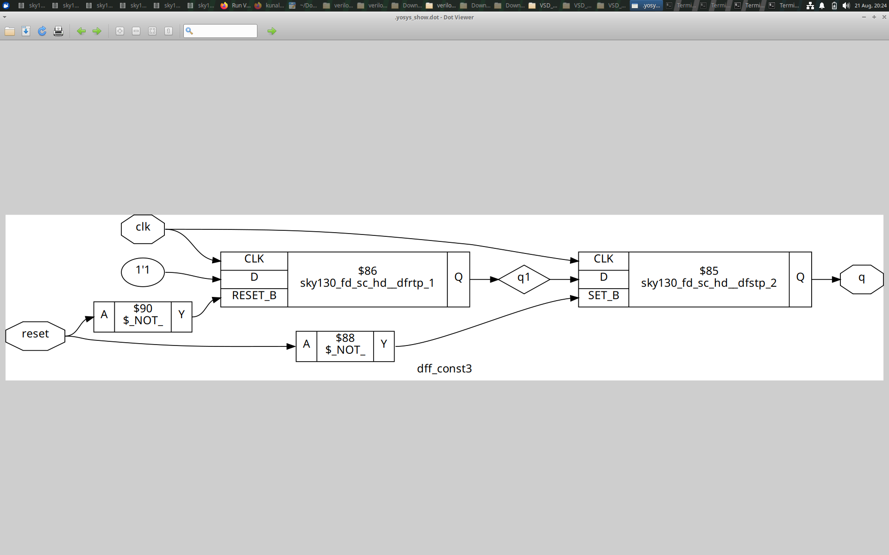
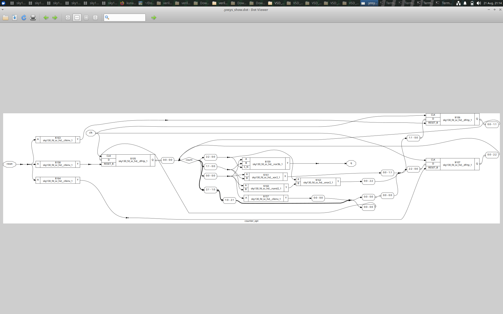
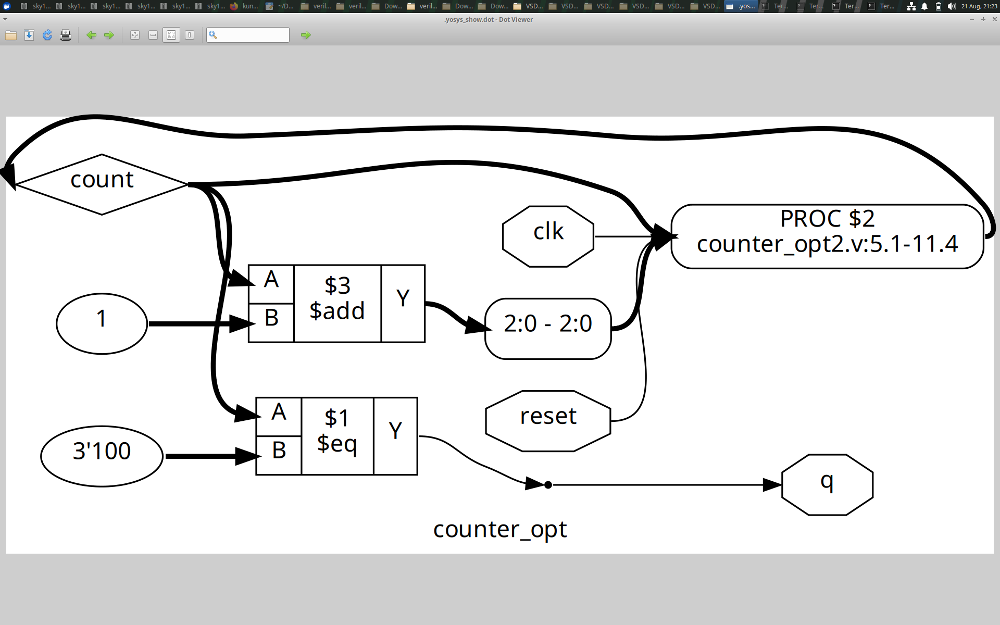

# DAY 3 — Combinational & Sequential Optimization

## 1. Module Overview

DAY 3 focuses on an important synthesis principle:

> **RTL syntax does not necessarily translate one-to-one into physical hardware.**

Synthesis analyzes the functionality described by RTL and can remove logic that is constant, redundant or unnecessary for the observable behavior.

The experiments in this module focus on:

- constant-driven DFF cases,
- removal/simplification of unnecessary sequential logic,
- and counter optimization.

---

## 2. Learning Objectives

The module aims to develop the ability to:

- recognize constant-driven hardware,
- understand constant propagation,
- identify redundant state,
- compare unoptimized and optimized structures,
- distinguish RTL syntax from final hardware,
- and evaluate optimization in terms of preserved functionality and reduced hardware.

---

# Experiment 1 — Constant DFF Optimization: Case 1

## Objective

Investigate a sequential design where the register behavior leads to a constant or otherwise predetermined value.





## Concept

A flip-flop is useful when it represents state that can change and must be retained.

If synthesis can prove that a registered value is always constant, the storage element may no longer contribute useful state to the final function.

Conceptually:

```text
RTL contains state
        ↓
Synthesis analyzes behavior
        ↓
State proven constant
        ↓
Storage may become unnecessary
        ↓
Logic can be simplified
```

This is an example of **constant propagation and redundant sequential logic removal**.

## What to Compare

Compare the RTL-oriented figure with the synthesized schematic.

Look for:

- whether the DFF remains,
- whether the output has become a constant,
- whether surrounding logic has also been simplified.

## Learning

A register appearing in RTL does not guarantee that a physical flip-flop must remain in the optimized netlist.

---

# Experiment 2 — Constant DFF Optimization: Case 2

## Objective

Study another constant-driven sequential condition and observe how synthesis handles it.





## Concept

When a signal is mathematically determined by the RTL, synthesis can propagate that information through connected logic.

This can affect:

- registers,
- combinational gates,
- control paths,
- and downstream outputs.

## Observation

The important question is not:

> "How many flip-flops were written in RTL?"

The useful question is:

> "How many flip-flops are actually necessary to implement the observable behavior?"

That distinction is central to synthesis optimization.

---

# Experiment 3 — Constant DFF Optimization: Case 3

## Objective

Reinforce the concept of redundant or constant state through a third implementation.




## Concept

If a sequential element does not represent meaningful variable state, synthesis can simplify or remove it.

This is part of a broader class of optimization in which the tool identifies logic whose value can be determined without physically implementing the original RTL structure.

## Learning

Optimization can reduce:

- unnecessary state elements,
- redundant combinational logic,
- control complexity,
- and overall hardware structure.

---

# Experiment 4 — Counter Optimization

## Objective

Compare a normal counter implementation with an optimized counter and understand how equivalent functionality can be implemented with less unnecessary hardware.





## Concept

A counter is a sequential circuit whose state changes in a predictable sequence.

```text
Clock
  ↓
┌─────────────┐
│ Counter     │
│ State       │
└──────┬──────┘
       ↓
   Next State
       ↓
   Next Clock
```

A synthesis tool can analyze the counter's required behavior and simplify logic when some state bits, controls or transitions are redundant.

## What to Compare

When comparing the two figures, examine:

1. Number of sequential elements.
2. Combinational logic around the state.
3. State/control signals.
4. Whether the count sequence is preserved.
5. Which logic has disappeared or been simplified.

## Important Point

Optimization is not about making the source code visually shorter.

The correct objective is:

```text
Same required behavior
        +
Less unnecessary hardware
```

## Learning

A design should be evaluated in terms of **functional equivalence and implementation efficiency**.

---

# Module 3 — Optimization Principles

The experiments demonstrate several synthesis ideas.

### Constant Propagation

Known values can be propagated through the logic.

### Redundant State Removal

State elements that no longer contribute meaningful variable behavior can be removed or simplified.

### Logic Simplification

When some conditions become unnecessary, connected combinational logic can also be simplified.

### Functional Equivalence

An optimization is useful only when the required behavior is preserved.

---

## DAY 3 Takeaway

DAY 3 develops a synthesis-oriented question:

> **Does every RTL construct contribute necessary hardware?**

If the answer is no, synthesis may be able to optimize it away.
