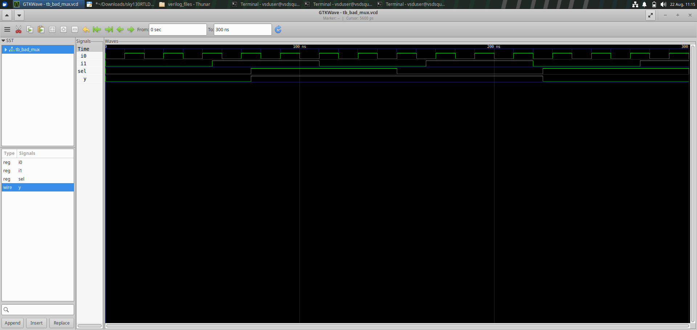
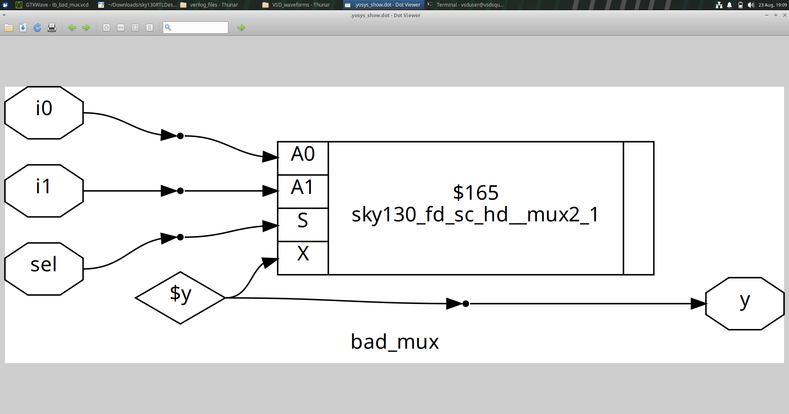
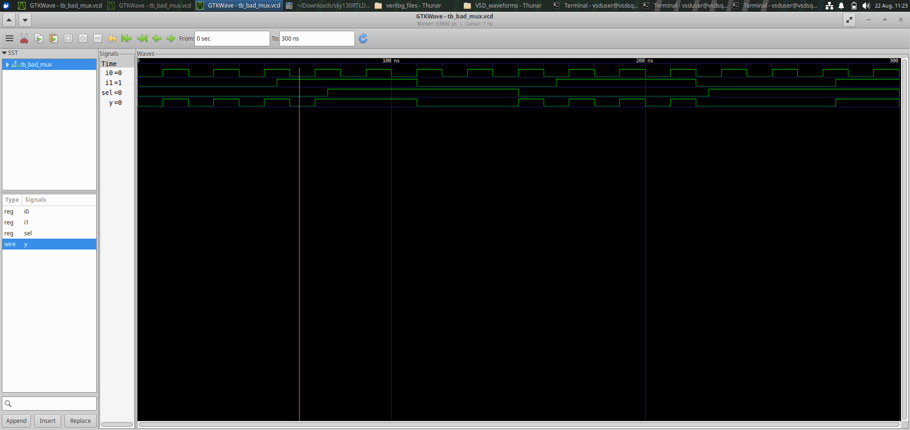
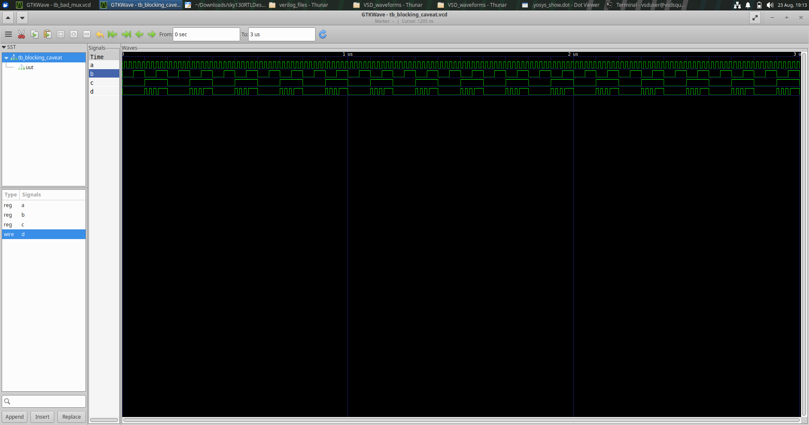
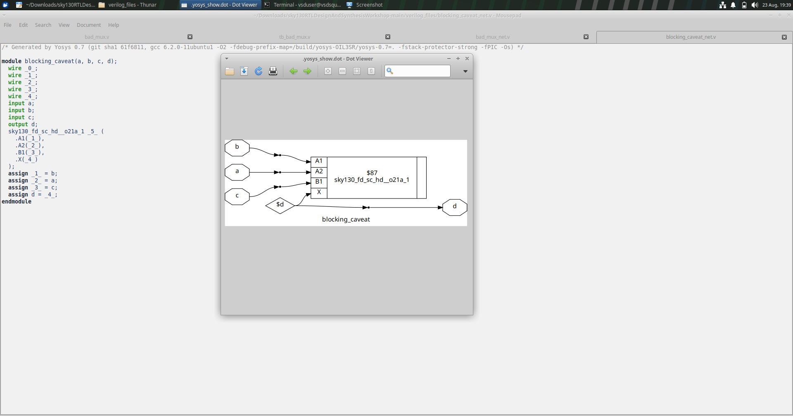
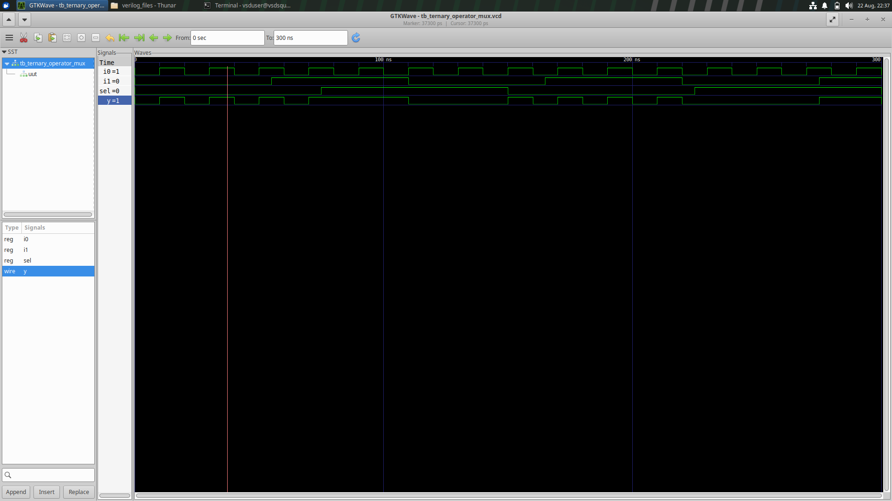
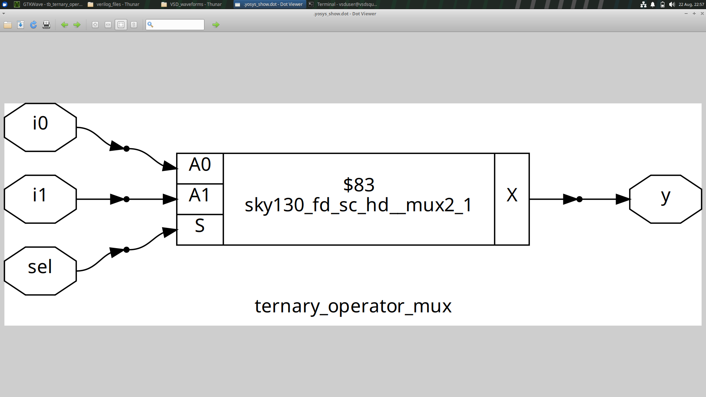

# DAY 4 — GLS, Blocking vs Non-Blocking & Synthesis Simulation

## 1. Module Overview

DAY 4 studies the relationship between **RTL coding style, simulation semantics and synthesized hardware**.

The experiments are especially useful because an RTL description can be syntactically legal and still fail to communicate the intended hardware clearly.

The module covers:

- problematic MUX coding,
- incomplete/ambiguous combinational descriptions,
- blocking assignment behavior,
- non-blocking assignment semantics,
- ternary MUX coding,
- synthesis inspection,
- and Gate-Level Simulation (GLS).

---

## 2. Why RTL and GLS Must Be Compared

A useful hardware-development flow is:

```text
RTL
 ↓
RTL Simulation
 ↓
Synthesis
 ↓
Gate-Level Netlist
 ↓
GLS
 ↓
Behavior Comparison
```

RTL simulation checks the behavioral description.

GLS works with the synthesized gate-level representation and therefore provides an additional opportunity to verify the behavior of the implementation generated by synthesis.

---

# Experiment 1 — Bad MUX

## Objective

Study an intentionally problematic MUX description and determine what hardware the synthesis process produces.







## Concept

A combinational block should define its outputs for all relevant input conditions.

If an output is not completely specified, the synthesis tool may infer behavior that is different from the simple combinational MUX the designer intended.

For a clean 2:1 MUX:

```text
S = 0 → Y = A
S = 1 → Y = B
```

The experiment asks whether the RTL actually describes this relationship completely.

## What to Investigate

- Are all selection conditions covered?
- Is the output assigned under every condition?
- Does the netlist contain only the expected selection logic?
- Does the resolved version make the intended behavior clearer?

## Learning

Combinational completeness is essential for predictable synthesis.

---

# Experiment 2 — Blocking Assignment Caveat

## Objective

Understand why blocking assignments need careful use in sequential RTL.





## Concept

Blocking assignment:

```verilog
A = B;
```

updates the procedural variable immediately during procedural execution.

Non-blocking assignment:

```verilog
A <= B;
```

schedules the update so that the state changes together with other non-blocking updates at the appropriate simulation time.

A simple conceptual comparison is:

```text
Blocking

A = B;
C = A;

C can see the newly assigned A
```

versus:

```text
Non-blocking

A <= B;
C <= A;

C uses the previous A value
```

This difference is especially important in clocked logic.

## Why This Matters

The assignment operator affects simulation semantics and can therefore influence whether the RTL simulation accurately reflects the intended simultaneous behavior of sequential hardware.

## Learning

Coding style should communicate hardware intent, not simply produce a desired simulation trace.

---

# Experiment 3 — Ternary Operator MUX

## Objective

Study a clear RTL representation of a MUX using the conditional operator.





## Concept

The conditional operator:

```text
Y = S ? A : B
```

directly expresses a 2:1 selection.

It is useful when the hardware requirement is naturally a simple conditional selection.

## What to Compare

Compare:

- the compact RTL expression,
- the resulting synthesized structure,
- and the expected MUX function.

The experiment demonstrates how an RTL operator can map naturally to combinational selection hardware.

---

# Experiment 4 — RTL vs Synthesis vs GLS Perspective

## Objective

Develop a disciplined way of checking a design after synthesis.

## Concept

There are three useful viewpoints:

### RTL View

"What did I describe?"

### Synthesis View

"What hardware did the synthesis tool infer?"

### GLS View

"Does the synthesized gate-level representation behave as expected under simulation?"

```text
         RTL Intent
             ↓
      RTL Simulation
             ↓
          Synthesis
             ↓
      Gate-Level Netlist
             ↓
            GLS
```

## Learning

A successful RTL simulation is important, but it is not the only checkpoint. Inspecting the synthesized representation and, where required, running GLS provides additional confidence that the RTL-to-hardware transition is behaving as intended.

---

# Blocking vs Non-Blocking — Summary

| Assignment | Main simulation behavior | Typical design intent |
|---|---|---|
| `=` | Immediate procedural update | Commonly used for combinational procedural logic |
| `<=` | Scheduled update | Commonly used for clocked sequential logic |

The important lesson is not to treat these as interchangeable syntax.

---

## DAY 4 Takeaway

DAY 4 develops awareness of the complete relationship:

```text
Coding Style
     ↓
Simulation Semantics
     ↓
RTL Behavior
     ↓
Synthesis
     ↓
Gate-Level Representation
     ↓
GLS
```

Good RTL should be clear in both **what it simulates** and **what hardware it intends to describe**.
