# Module 5 — Optimization in Synthesis

## 1. Module Overview

Module 5 is the most synthesis-oriented part of the workshop.

The experiments investigate how conditional coding, completeness, generate constructs and structured arithmetic descriptions influence the inferred hardware.

The central question is:

> **How can RTL be written so that the intended hardware is complete, predictable and synthesis-friendly?**

The module includes experiments involving:

- `case`,
- incomplete `case`,
- `if`,
- incomplete `if`,
- MUX,
- DEMUX,
- generate constructs,
- partial assignments,
- ripple-carry addition,
- and GLS.

---

# Experiment 1 — Problematic / Incomplete Case

## Objective

Understand the hardware implications of an incomplete `case` description.


## Concept

A `case` statement selects behavior according to a control expression.

For combinational logic, the output must have a defined value for every relevant condition.

If some conditions are not assigned, the description can imply that the output needs to retain its previous value rather than simply being recomputed.

## Key Question

Is the designer intentionally describing storage, or is the output supposed to be purely combinational?

That question should always be answered explicitly.

---

# Experiment 2 — Bad Case and GLS

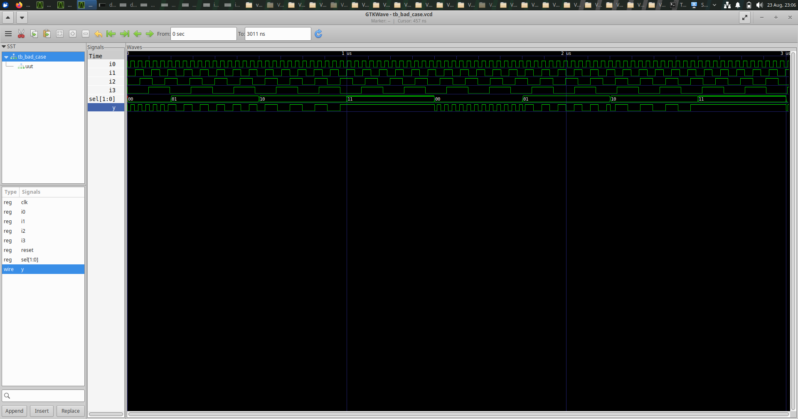

## Objective

Observe the synthesized/gate-level behavior associated with the case implementation.

## Concept

Gate-Level Simulation provides a view of how the synthesized representation behaves rather than only how the original RTL behaves.

This is useful when studying coding constructs whose synthesis interpretation can be different from the designer's initial expectation.

## Learning

GLS can help expose implementation-level behavior that deserves investigation.

---

# Experiment 3 — Complete Case

## Objective

Study a complete case description and compare its synthesized representation with the intended combinational structure.

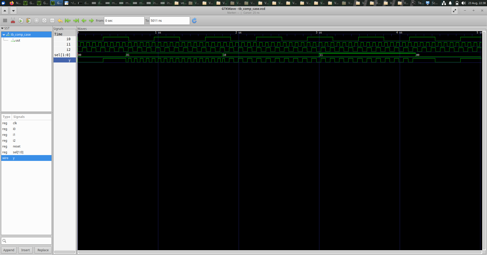

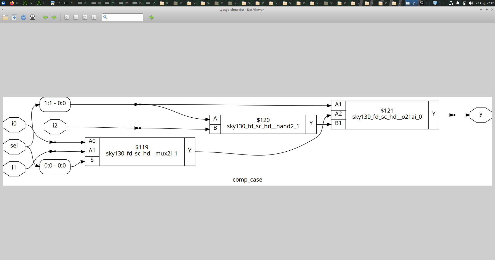

## Concept

A complete case structure assigns the required outputs for the relevant selection conditions.

This makes the intended combinational behavior explicit and reduces ambiguity during synthesis.

## What to Compare

- completeness of assignments,
- number of logic elements,
- presence or absence of storage,
- and correspondence between RTL and netlist.

## Learning

Completeness is a fundamental requirement for predictable combinational RTL.

---

# Experiment 4 — Case-Based DEMUX

## Objective

Understand how a DEMUX can be represented using a selection statement.

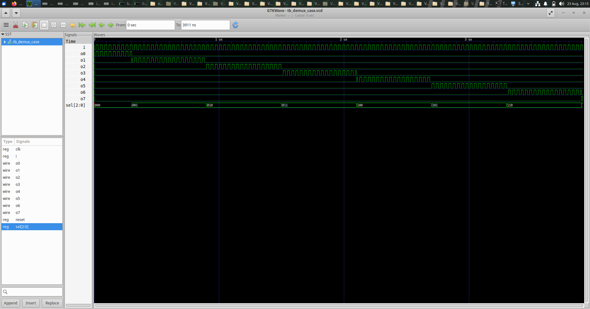

## Concept

A DEMUX routes one input to one of several outputs according to select signals.

```text
                  ┌─────────┐
Input ───────────►│  DEMUX  │──► Y0
Select ──────────►│         │──► Y1
                  │         │──► ...
                  └─────────┘
```

A case statement can describe which output should receive the input for each select condition.

## Learning

The experiment connects selection-oriented RTL with routing hardware.

---

# Experiment 5 — Generate-Based DEMUX

## Objective

Study a DEMUX described using Verilog generate constructs.


## Concept

A generate construct creates repeated hardware during elaboration.

This is particularly useful when the circuit has a regular structure that would otherwise require repetitive RTL.

Conceptually:

```text
Generate index 0 → hardware instance 0
Generate index 1 → hardware instance 1
Generate index 2 → hardware instance 2
...
```

## Important Distinction

Generate constructs operate during elaboration. They are not software loops that execute during hardware operation.

## Learning

Generate constructs are useful for describing parameterized and repeated hardware structures.

---

# Experiment 6 — Generate-Based MUX

## Objective

Study another generated selection structure.

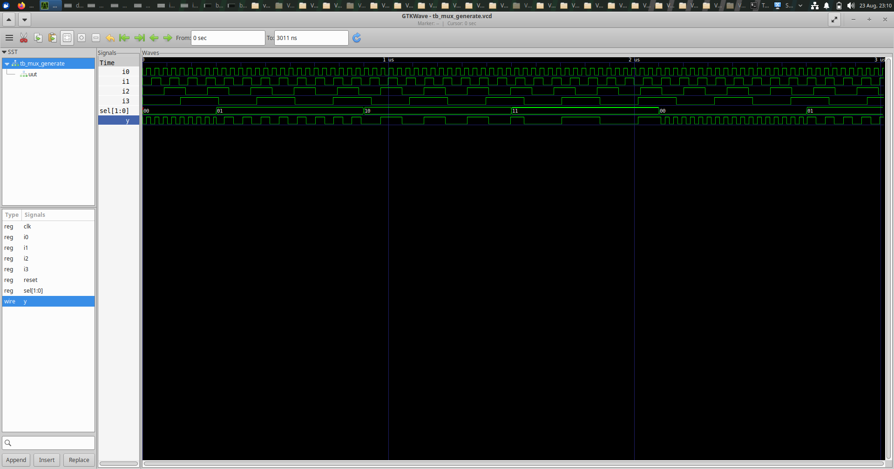

## Concept

A regular MUX structure can be built from repeated pieces of logic. Generate constructs allow those repeated structures to be described systematically.

## Observation

The important design consideration is whether the generated structure clearly represents the desired connectivity and whether synthesis produces the expected combinational hardware.

---

# Experiment 7 — Incomplete IF

## Objective

Understand why incomplete conditional assignments can cause unintended hardware.

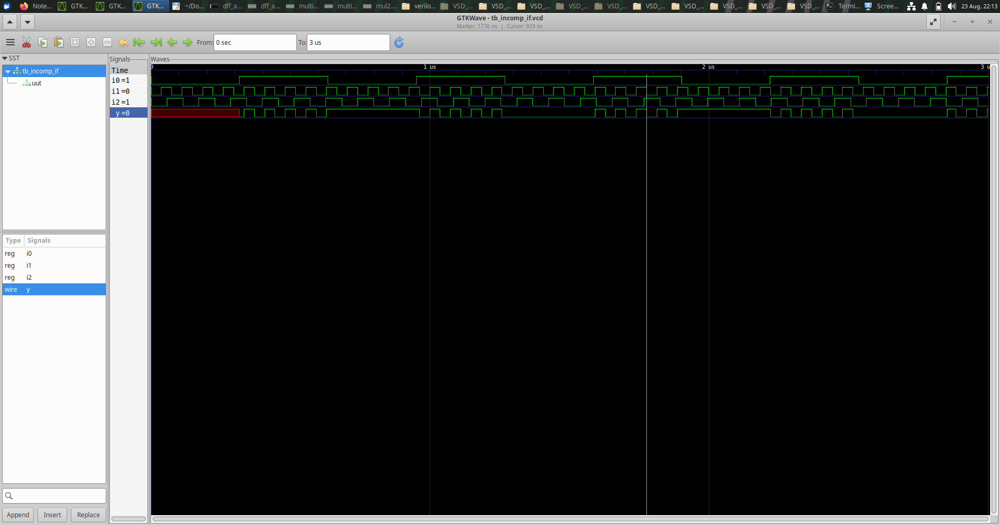

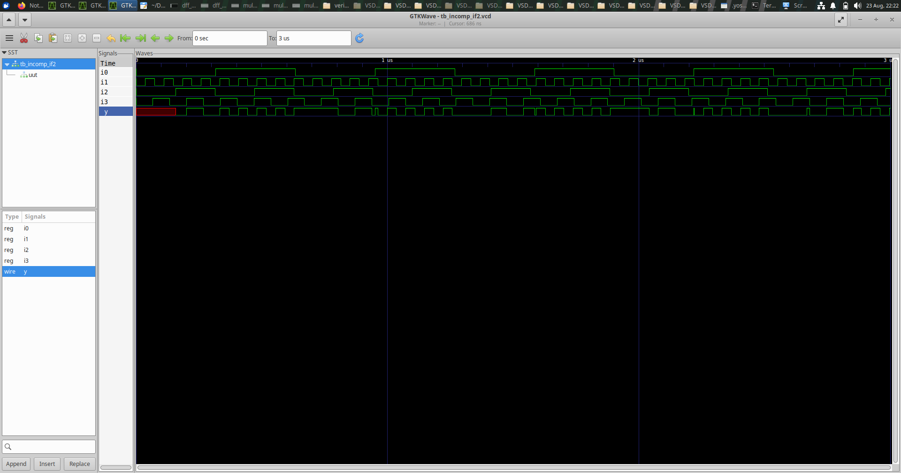

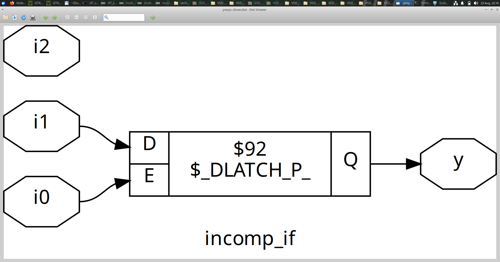

## Concept

Consider:

```verilog
if (condition)
    y = value;
```

If no value is assigned when the condition is false, the design has not specified what `y` should be in that situation.

For combinational intent, this may imply that `y` must retain its previous value.

That behavior is associated with storage rather than a purely combinational path.

## Corrective Principle

A combinational output should normally be assigned for every relevant condition, for example through:

```text
default assignment
       OR
complete if/else
       OR
complete selection structure
```

## Learning

Incomplete combinational assignments are one of the most important RTL issues demonstrated in the workshop.

---

# Experiment 8 — Incomplete Case

## Objective

Study an incomplete case description and inspect the resulting netlist.

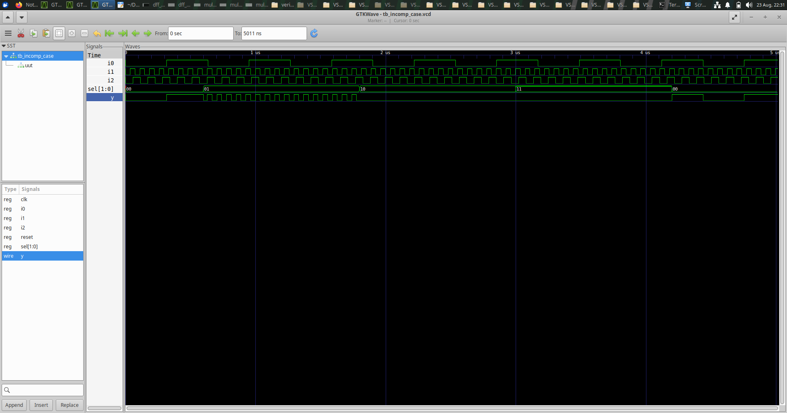

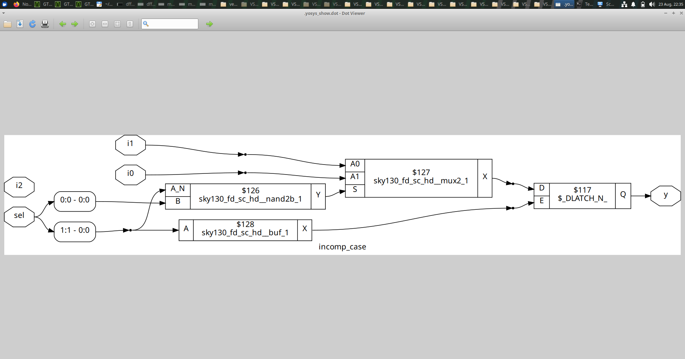

## Concept

If some selection conditions do not assign the output, the hardware requirement is no longer equivalent to a fully specified combinational selection.

The synthesized netlist therefore becomes a useful diagnostic tool.

## What to Observe

Compare the expected MUX/selection behavior with the actual synthesized structure.

The goal is to recognize that **missing RTL assignments can become real hardware behavior**.

---

# Experiment 9 — Partial Case Assignment

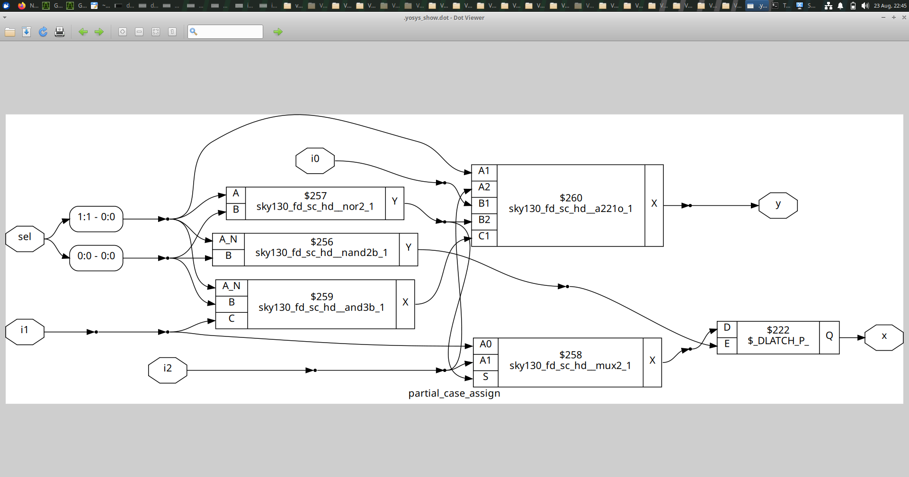

## Objective

Study the effect of assigning only part of the output behavior.

## Concept

Partial assignment is especially important for multi-bit signals. If some bits are assigned while others are left unspecified under certain conditions, synthesis must preserve whatever behavior the RTL implies for the unspecified portions.

## Learning

The designer should make the complete output intent explicit instead of relying on unspecified or retained values.

---

# Experiment 10 — Ripple Carry Adder

## Objective

Understand the structure of a ripple-carry adder and its relevance to synthesis.

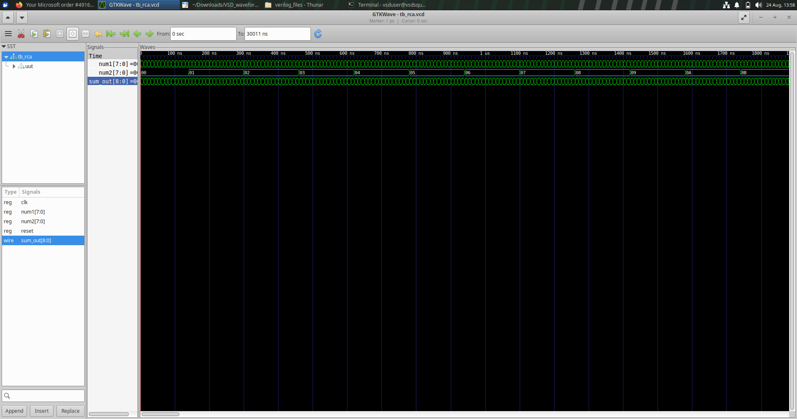

## Concept

An RCA is formed by connecting full-adder stages in sequence.

```text
A0 B0 ──► FA0 ──C1──► FA1 ──C2──► FA2 ──C3──► ...
             │             │             │
             S0            S1            S2
```

Each stage produces a sum and passes its carry to the next stage.

## Hardware Significance

The structure is regular and easy to understand, but the carry dependency creates a path through the adder stages.

This makes the RCA a useful example for discussing:

- combinational depth,
- repeated structures,
- arithmetic RTL,
- carry propagation,
- and synthesis implementation.

## Learning

An arithmetic operation at RTL represents a real combinational hardware requirement. The structure and timing implications still matter after synthesis.

---

# Experiment 11 — Conditional / IF Comparison

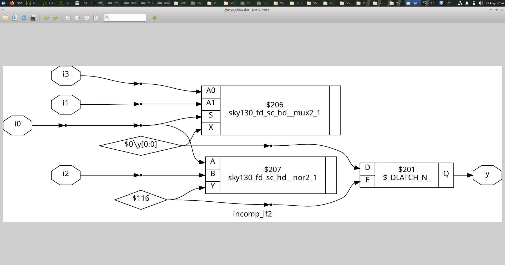

## Objective

Study another conditional implementation and relate the RTL form to the synthesized behavior.

## Concept

Different RTL descriptions can express the same logical function while communicating different levels of priority, completeness or structural intent.

The important synthesis question is:

> Does the coding style clearly describe the hardware that is required?

---

# Synthesis Optimization Concepts Demonstrated

## 1. Constant Propagation

Known values can be propagated through logic so that unnecessary gates and state elements can be removed.

## 2. Complete Combinational Assignment

Every combinational output should have a defined value for every relevant condition.

## 3. Avoiding Unintended Storage

Incomplete `if` and `case` descriptions can imply retained values. If storage is not intended, the RTL should explicitly define all paths.

## 4. Priority and Selection

`if` and `case` coding can communicate selection and priority behavior. The designer should be deliberate about the intended relationship.

## 5. Generate-Based Structures

Generate constructs are useful for repeated and parameterized hardware.

## 6. Netlist Inspection

The netlist is an important design-debugging resource. It reveals what the synthesis tool inferred from the RTL.

## 7. Functional Equivalence

Optimization must preserve the required functionality. Reduced hardware is valuable only when the intended behavior remains correct.

---

# Module 5 — Overall Learning

The experiments demonstrate a practical synthesis-oriented workflow:

```text
Write RTL
   ↓
Check completeness
   ↓
Simulate
   ↓
Synthesize
   ↓
Inspect Netlist
   ↓
Run GLS where required
   ↓
Identify unintended hardware
   ↓
Improve RTL
```

## Module 5 Takeaway

The most important lesson is:

> **Good RTL is not only functionally correct. It should also make the intended hardware structure explicit and predictable to synthesis.**
