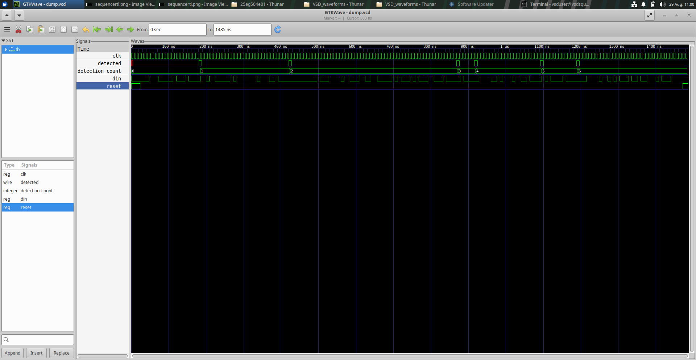

# RTL Design Workshop - Day 7

## Sequence Detector Design and Verification

---

## Index

1. [Introduction](#1-introduction)
2. [Objective](#2-objective)
3. [Design Description](#3-design-description)
4. [Simulation and Waveforms](#4-simulation-and-waveforms)
5. [RTL and Synthesis Views](#5-rtl-and-synthesis-views)
6. [Results](#6-results)
7. [Conclusion](#7-conclusion)
8. [Files](#files)
9. [Tools Used](#tools-used)
10. [Key Learnings](#key-learnings)

## 1. Introduction

Day 7 of the RTL Design Workshop focuses on the design and verification of a sequence detector. A sequence detector is a sequential circuit that monitors an input bit stream and identifies a predefined pattern.

## 2. Objective

- Understand the operation of a sequence detector.
- Observe clock, reset, input, and detection signals.
- Verify the design using simulation waveforms.
- Analyze the detection count and output behavior in GTKWave.

## 3. Design Description

The sequence detector processes the serial input `din` using clock-driven sequential logic. The `reset` signal initializes the design, while `detected` indicates when the target sequence is recognized. The `detection_count` signal records the number of detections.

## 4. Simulation and Waveforms

The simulation waveform was viewed using GTKWave. The screenshot displays the following signals:

- `clk` — clock signal.
- `reset` — reset signal.
- `din` — serial input data.
- `detected` — sequence detection output.
- `detection_count` — detection counter.

The waveform allows the relationship between the input data, clock, reset, detection output, and detection counter to be observed over simulation time.

### GTKWave Simulation Screenshot

## 5. RTL and Synthesis Views

The GTKWave simulation provides a signal-level view of the sequence detector's behavior. The displayed signals can be used to examine detection events and counter updates during the simulation.

A separate RTL schematic or synthesized netlist image was not included in the supplied screenshot, so no structural synthesis result is claimed here.

## 6. Results

- The sequence detector simulation was opened and observed in GTKWave.
- The input, clock, reset, detection output, and detection counter are visible.
- Detection events and counter changes can be examined using the waveform.
- The screenshot documents the simulation environment and signal activity.

## 7. Conclusion

This exercise demonstrates the simulation and observation of a sequential sequence detector using GTKWave. It helps develop an understanding of clocked logic, reset behavior, sequence detection, and output monitoring.

## Files

- [sequencedetectorrtl.png](sequencedetectorrtl.png) — GTKWave simulation waveform showing the sequence detector signals.

## Tools Used

- Verilog HDL / RTL
- RTL simulation
- GTKWave
- Digital sequential logic

## Key Learnings

- Sequence detector operation
- Clock and reset behavior
- Serial input monitoring
- Detection output analysis
- Detection counter observation
- Waveform-based verification
