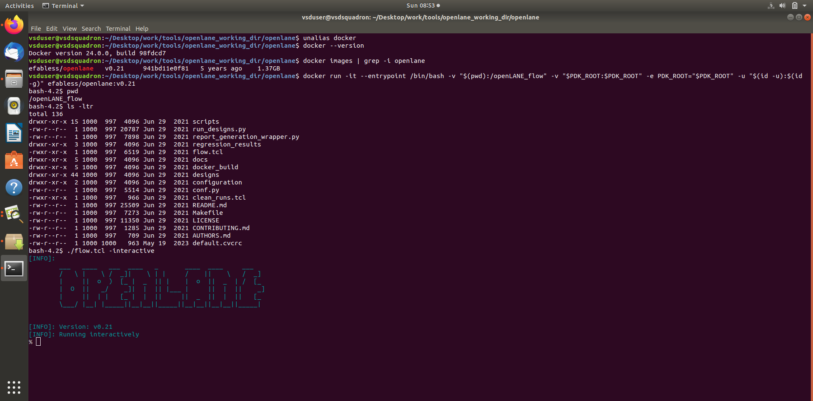
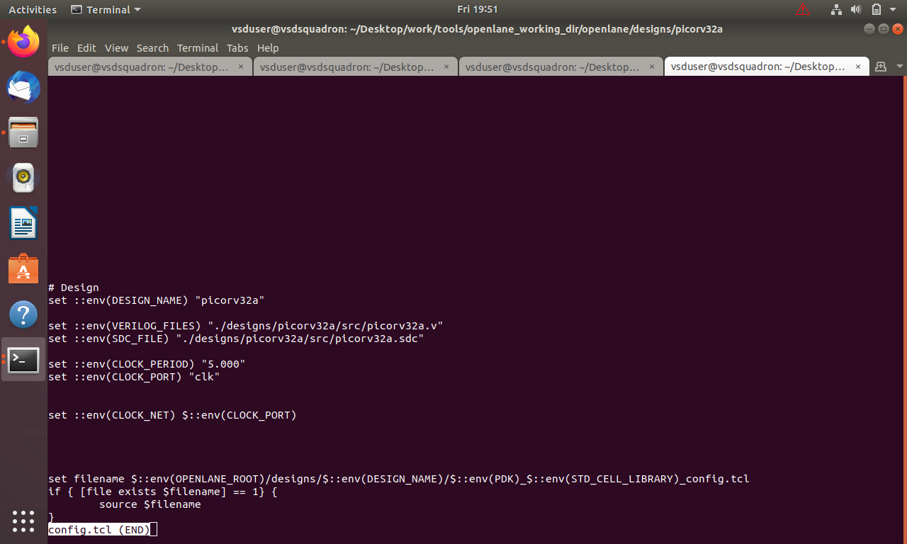
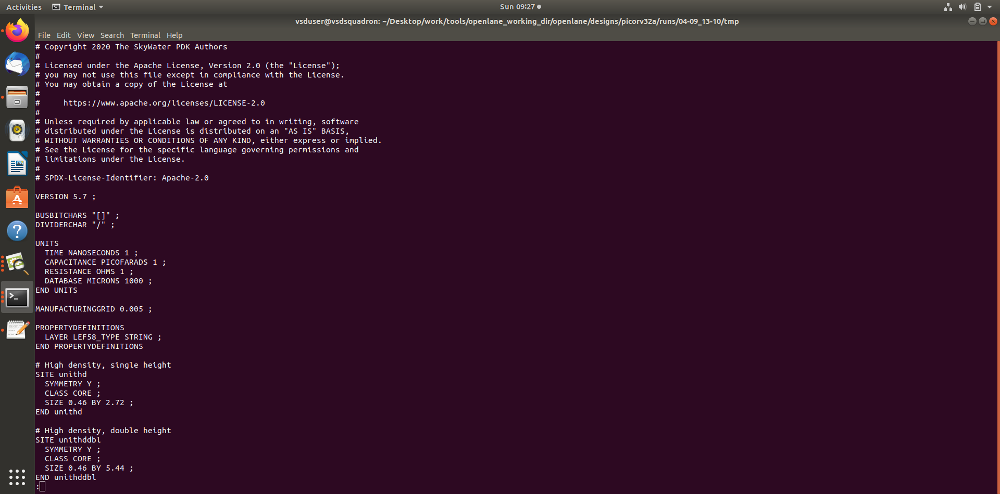
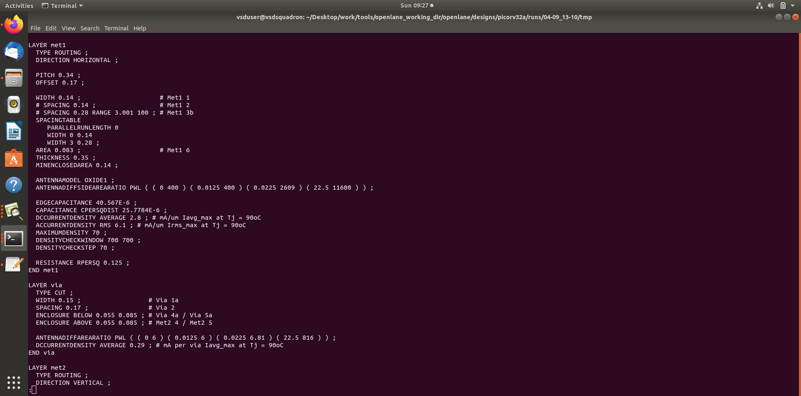
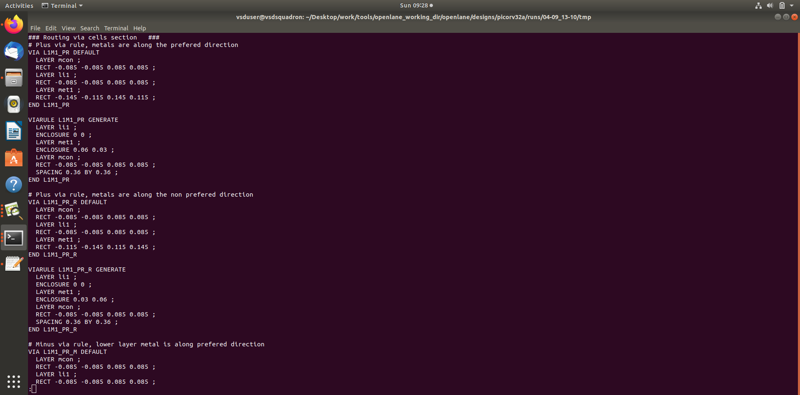
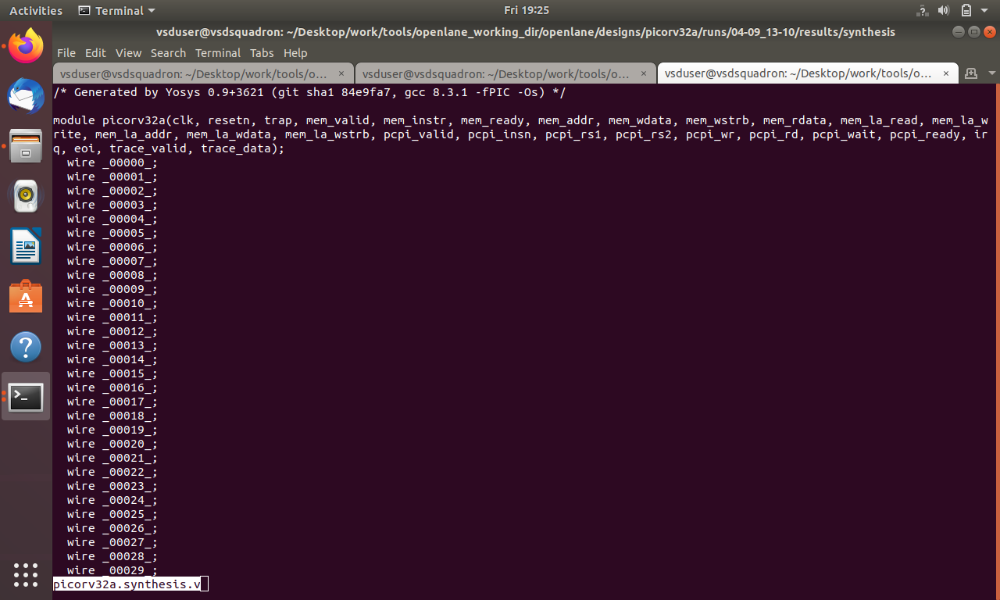
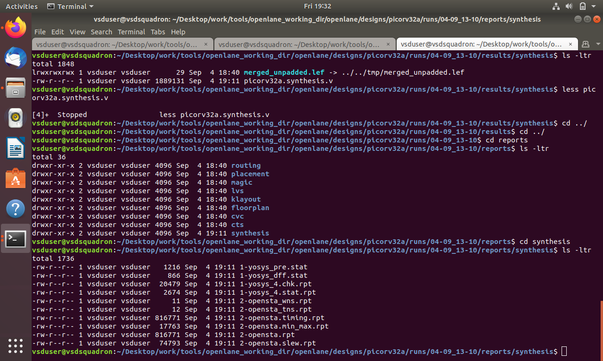
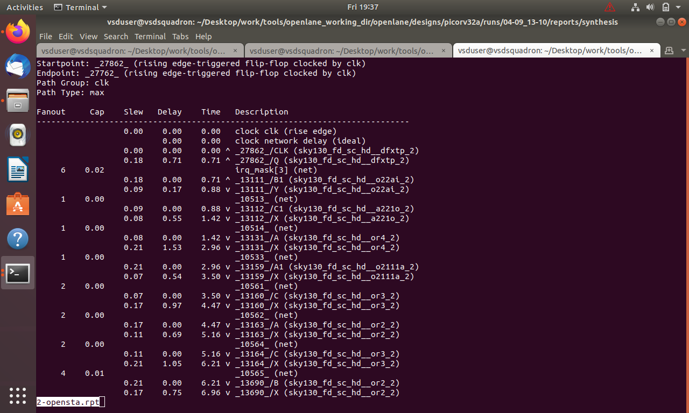
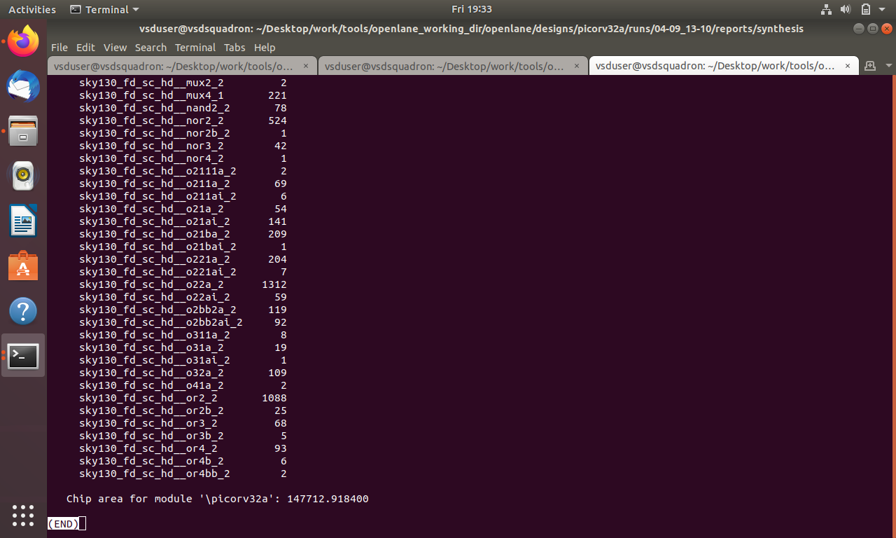
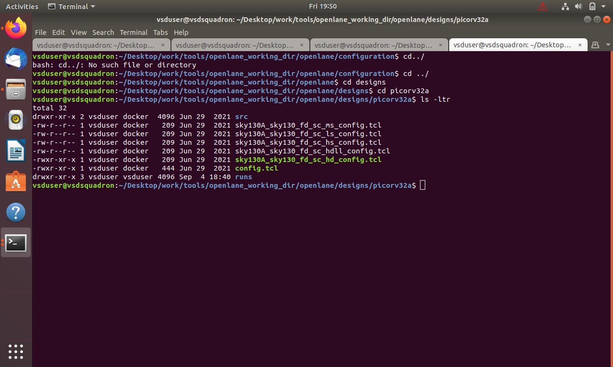

# MODULE 6 — OpenLane RTL-to-Physical Design Preparation: Setup, Configuration, LEF, Synthesis and STA

## 1. Introduction

Module 6 documents the OpenLane work performed for the **PicoRV32A** design using the **Sky130A** technology environment. The evidence covers the OpenLane environment, design configuration, technology LEF information, synthesis, static timing analysis, area/cell statistics and the overall RTL-to-GDSII flow.

The purpose of this module is to understand how a Verilog RTL design is prepared for physical implementation and how synthesis and timing information are obtained before the detailed physical-design stages documented in Module 7.

---

## 2. Design and Technology

| Item | Value |
|---|---|
| Design | `picorv32a` |
| Technology | Sky130A |
| RTL | `picorv32a.v` |
| Timing constraints | `picorv32a.sdc` |
| Clock port | `clk` |
| OpenLane flow | RTL-to-GDSII |
| Main tools involved | OpenLane, Yosys, OpenROAD, OpenSTA |
| Technology information | Sky130A LEF / standard-cell library |

---

# 3. Objectives

1. Understand the OpenLane environment.
2. Understand the PicoRV32A design directory.
3. Study the OpenLane configuration.
4. Understand timing constraints.
5. Understand LEF and merged LEF information.
6. Run/inspect synthesis.
7. Read synthesis reports.
8. Understand technology-mapped standard cells.
9. Inspect static timing analysis.
10. Understand area and cell statistics.
11. Connect synthesis and STA to the later physical-design stages.

---

# 4. Experiment 1 — OpenLane Environment

## Aim

To understand the OpenLane environment used for RTL-to-GDSII implementation.

OpenLane combines open-source tools into a digital ASIC implementation flow. The important concept is that the RTL is not directly converted into a final layout in one step. It passes through synthesis, timing analysis and then physical implementation stages.

<p align="center"></p>

### What this evidence demonstrates

The screenshot records the OpenLane environment used for the project. It establishes the software environment in which the subsequent configuration and implementation work is performed.

---

# 5. Experiment 2 — PicoRV32A Design Configuration

## Aim

To identify the design, RTL source, timing constraint file and clock settings.

The design configuration contains the PicoRV32A design and points OpenLane toward the RTL and SDC files.

<p align="center"></p>

Typical parameters shown include:

```tcl
set ::env(DESIGN_NAME) "picorv32a"
set ::env(VERILOG_FILES) "./designs/picorv32a/src/picorv32a.v"
set ::env(SDC_FILE) "./designs/picorv32a/src/picorv32a.sdc"
set ::env(CLOCK_PERIOD) "5.000"
set ::env(CLOCK_PORT) "clk"
```

### Explanation

- `DESIGN_NAME` identifies the design.
- `VERILOG_FILES` points to the RTL.
- `SDC_FILE` points to timing constraints.
- `CLOCK_PERIOD` defines the configured clock period.
- `CLOCK_PORT` identifies the clock input.

These variables connect the logical RTL design to synthesis and timing analysis.

---

# 6. Experiment 3 — Simplified Configuration / Configuration Variables

## Aim

To understand the configuration information required by OpenLane.

<p align="center"></p>

The configuration establishes the basic information needed for the design flow, including the design name, source RTL, timing information and clock definition.

### Important concept

A physical-design flow is highly dependent on correct configuration. A wrong design path, clock name or timing constraint can cause failures or produce meaningless timing results.

---

# 7. Experiment 4 — Sky130A Technology LEF

## Aim

To understand the technology and cell information required by physical-design tools.

The supplied LEF screenshots show the merged technology/cell LEF information used by the flow.

<p align="center"></p>

### What is LEF?

**LEF — Library Exchange Format** describes physical information needed by placement and routing tools.

LEF can contain information about:

- metal layers
- routing directions
- layer widths
- spacing
- vias
- cell dimensions
- pin locations
- obstruction information

LEF is therefore different from RTL.

RTL describes **function**; LEF describes important **physical implementation properties**.

---

# 8. Experiment 5 — LEF Metal-Layer Information

<p align="center"></p>

The technology LEF contains information that allows the physical-design tools to understand the available routing technology.

Important physical concepts include:

- metal layers
- preferred routing direction
- layer width
- spacing
- pitch
- vias
- routing constraints

These parameters influence placement and routing.

---

# 9. Experiment 6 — LEF Via and Routing Information

<p align="center"></p>

Vias connect different metal layers.

A simplified routing stack can be represented as:

```text
Metal 3
   |
  Via
   |
Metal 2
   |
  Via
   |
Metal 1
```

The physical-design tools need the technology information before they can create legal interconnect.

---

# 10. Experiment 7 — Synthesis of PicoRV32A

## Aim

To understand the conversion from RTL into a technology-mapped gate-level representation.

<p align="center"></p>

Synthesis transforms:

```text
RTL
 ↓
Logic optimization
 ↓
Technology mapping
 ↓
Gate-level netlist
```

The synthesized design consists of technology-specific cells rather than only behavioral Verilog constructs.

### Why synthesis is important

Synthesis determines an initial implementation in terms of:

- combinational cells
- sequential cells
- buffers
- inverters
- multiplexers
- arithmetic logic
- other library elements

This netlist becomes the input to physical design.

---

# 11. Experiment 8 — Synthesis Report

## Aim

To inspect the synthesis results and understand the generated statistics.

<p align="center"></p>

A synthesis report can contain information about:

- number of cells
- cell types
- sequential elements
- combinational logic
- hierarchy
- warnings
- timing-related information
- area-related information

### Engineering significance

The synthesis report is an important checkpoint. Before physical implementation, the designer should verify that:

1. the RTL synthesized successfully,
2. the expected design is present,
3. there are no unexpected unmapped elements,
4. the clock and constraints are recognized,
5. the generated netlist is suitable for the next stage.

---

# 12. Experiment 9 — Static Timing Analysis

## Aim

To inspect timing behavior after synthesis.

<p align="center"></p>

OpenSTA performs **Static Timing Analysis (STA)**.

STA checks timing paths without requiring simulation of every possible input pattern.

A simplified timing path is:

```text
Launch FF
   |
   v
Combinational Logic
   |
   v
Data Path
   |
   v
Capture FF
```

For setup analysis:

```text
Data arrival time
        <
Required arrival time
```

For hold analysis, the data must not arrive too early at the capture element.

---

# 13. Experiment 10 — Timing Path Interpretation

The STA report is used to inspect the worst or critical timing paths.

Important concepts include:

### Startpoint

The point from which the timing path begins.

### Endpoint

The point where the path is captured.

### Data arrival

The calculated time at which data reaches the endpoint.

### Data required

The latest/earliest acceptable arrival depending on the timing check.

### Slack

Slack indicates timing margin.

Conceptually:

```text
Slack = Required Time - Arrival Time
```

Positive slack indicates available timing margin for that check; negative slack indicates a violation.

---

# 14. Experiment 11 — Cell Statistics and Chip Area

## Aim

To inspect the number and type of cells used by the synthesized design.

<p align="center"></p>

The statistics provide an understanding of the technology-mapped design.

Typical categories include:

- sequential cells
- combinational cells
- buffers
- inverters
- total cell count
- area

### Why area matters

Area is one of the main ASIC design constraints.

A larger design can lead to:

- larger die
- longer interconnect
- increased power
- greater routing demand

Therefore area and timing must be considered together.

---

# 15. Experiment 12 — PicoRV32A Physical/Design View

## Aim

To inspect the design representation generated during the flow.

<p align="center"></p>

This evidence provides a visual checkpoint of the PicoRV32A implementation.

The important learning is that the design progresses from a logical RTL description toward a representation that can be consumed by physical-design tools.

---

# 16. Experiment 13 — Connecting LEF, Netlist and Physical Design

Three important pieces are required for physical implementation:

```text
Technology / Cell LEF
        +
Synthesized Netlist
        +
Timing Constraints
        |
        v
Physical Design
```

### Netlist

Describes what cells are connected.

### LEF

Describes physical information needed to place and route those cells.

### SDC

Describes timing requirements.

Together they provide the physical-design tools with the logical, physical and timing information needed for implementation.

---

# 17. Experiment 14 — RTL-to-GDSII Flow

The overall flow can be summarized as:

```text
RTL
 |
 v
Synthesis
 |
 v
Gate-Level Netlist
 |
 +---- LEF / Technology Information
 |
 +---- SDC / Timing Constraints
 |
 v
Floorplanning
 |
 v
IO Placement
 |
 v
PDN
 |
 v
Placement
 |
 v
CTS
 |
 v
Routing
 |
 v
Extraction
 |
 v
STA / Physical Verification
 |
 v
GDSII
```

Module 6 concentrates on the preparation, synthesis and timing side of this flow. Module 7 continues into the physical-design stages.

---

# 18. Important Commands

Typical OpenLane usage begins with:

```bash
./flow.tcl -interactive
```

Preparation and classic interactive-flow commands can include:

```tcl
prep -design picorv32a
run_synthesis
```

Useful Linux inspection commands:

```bash
ls
cd runs
ls
```

The exact command names can vary with the OpenLane release and flow configuration.

---

# 19. Observations

1. PicoRV32A is used as the design under implementation.
2. The design is configured using Tcl.
3. The RTL source and SDC file are explicitly identified.
4. The clock port is `clk`.
5. The design configuration shows a 5.000 clock-period value.
6. Sky130A technology information is represented through LEF.
7. Synthesis converts RTL into a technology-mapped implementation.
8. Synthesis reports provide cell and implementation information.
9. OpenSTA is used for timing analysis.
10. Cell statistics provide area/design-complexity information.
11. The synthesized design, LEF and timing constraints form the basis for physical implementation.

---

# 20. Results

The evidence demonstrates the preparation of PicoRV32A for physical implementation:

- OpenLane environment established.
- Design configuration reviewed.
- RTL and SDC paths identified.
- Sky130A LEF information inspected.
- Synthesis evidence obtained.
- Synthesis report reviewed.
- Static timing report inspected.
- Cell statistics and area information examined.
- Design representation inspected.

---

# 21. Key Learning

The most important concept is that **synthesis, timing constraints and technology libraries are connected**.

```text
RTL
 ↓
Synthesis
 ↓
Technology-mapped cells
 ↓
STA
 ↓
Physical implementation
```

A physically good design cannot be produced by considering only RTL functionality. Timing and technology information must be available before physical implementation.

---

# 22. Evidence Integrity

This README documents the supplied Module 6 evidence. It does not claim a final GDSII, DRC, LVS or routed database unless separately provided.

---

# 23. Conclusion

Module 6 establishes the foundation for physical design by showing the OpenLane environment, PicoRV32A configuration, Sky130A LEF information, synthesis, timing analysis and design statistics.

The next stage is Module 7, where the design moves into floorplanning, IO placement, PDN preparation and standard-cell placement.

