# MODULE 7 — OpenLane Physical Design: Floorplanning, IO Placement, PDN and Standard-Cell Placement

## 1. Introduction

Module 7 continues the PicoRV32A OpenLane work from Module 6 and focuses on the physical implementation stages.

The supplied evidence covers:

- design configuration review
- runtime/CTS configuration
- floorplan configuration
- DEF floorplan data
- IO placement
- physical IO cells
- floorplan visualization
- standard-cell placement
- detailed cell-level layout
- OpenLane configuration variables
- run-directory and physical-design logs
- PDN and tap-cell preparation

This module demonstrates the transition from a synthesized logical netlist to a physical arrangement of cells, pins, rows and power infrastructure.

---

# 2. Objectives

1. Understand physical-design configuration.
2. Understand floorplan utilization and aspect ratio.
3. Understand IO placement.
4. Understand the DEF physical representation.
5. Understand placement rows and orientation.
6. Understand PDN parameters.
7. Understand tap-cell processing.
8. Inspect physical IO cells.
9. Inspect standard-cell placement.
10. Inspect detailed Sky130 standard cells.
11. Understand OpenLane run directories and logs.
12. Connect floorplanning and placement to CTS and routing.

---

# 3. Design Configuration

## Experiment 1 — PicoRV32A Configuration

<p align="center"></p>

The configuration shows:

```tcl
set ::env(DESIGN_NAME) "picorv32a"
set ::env(VERILOG_FILES) "./designs/picorv32a/src/picorv32a.v"
set ::env(SDC_FILE) "./designs/picorv32a/src/picorv32a.sdc"
set ::env(CLOCK_PERIOD) "5.000"
set ::env(CLOCK_PORT) "clk"
set ::env(CLOCK_NET) $::env(CLOCK_PORT)
```

This connects the RTL, timing constraints and clock information to the physical-design flow.

---

# 4. Experiment 2 — Runtime and CTS Configuration

<p align="center">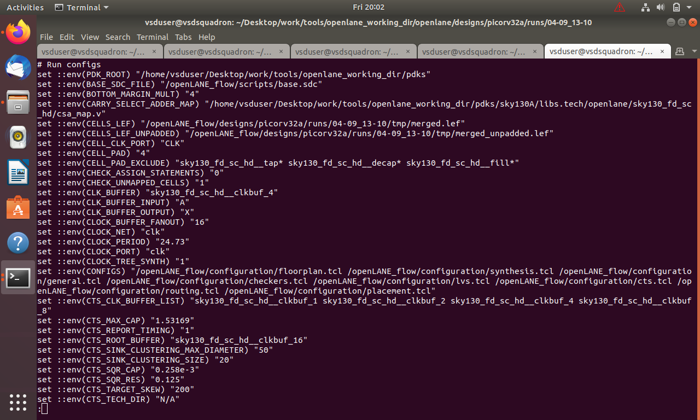</p>

The runtime configuration contains parameters such as:

```text
CLOCK_NET "clk"
CLOCK_PORT "clk"
CLOCK_PERIOD "24.73"
CLOCK_TREE_SYNTH "1"
CLOCK_BUFFER_FANOUT "16"
CTS_TARGET_SKEW "200"
CTS_ROOT_BUFFER "sky130_fd_sc_hd__clkbuf_16"
```

### Important distinction

The design configuration screenshot shows:

```text
CLOCK_PERIOD = 5.000
```

while the runtime configuration screenshot shows:

```text
CLOCK_PERIOD = 24.73
```

These are values visible in different configuration contexts and should not be presented as one identical setting.

The runtime screenshot also shows CTS controls such as:

- root clock buffer
- clock buffer fanout
- target skew
- sink clustering
- capacitance/resistance parameters

---

# 5. Experiment 3 — Floorplan Configuration

<p align="center">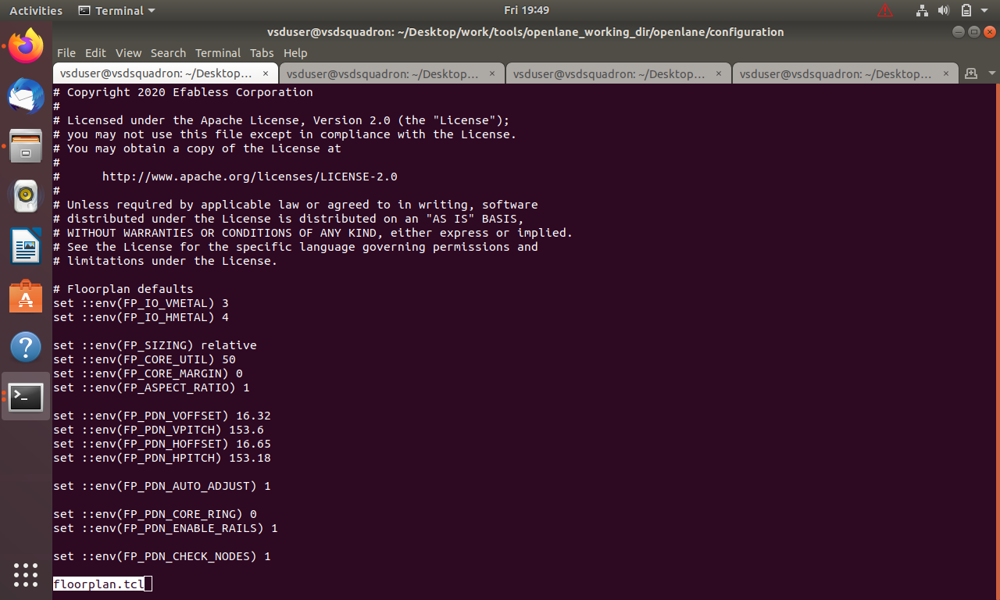</p>

The supplied configuration contains:

```tcl
set ::env(FP_IO_VMETAL) 3
set ::env(FP_IO_HMETAL) 4
set ::env(FP_SIZING) relative
set ::env(FP_CORE_UTIL) 50
set ::env(FP_CORE_MARGIN) 0
set ::env(FP_ASPECT_RATIO) 1
```

PDN-related parameters include:

```tcl
set ::env(FP_PDN_VOFFSET) 16.32
set ::env(FP_PDN_VPITCH) 153.6
set ::env(FP_PDN_HOFFSET) 16.65
set ::env(FP_PDN_HPITCH) 153.18
set ::env(FP_PDN_AUTO_ADJUST) 1
set ::env(FP_PDN_CORE_RING) 0
set ::env(FP_PDN_ENABLE_RAILS) 1
set ::env(FP_PDN_CHECK_NODES) 1
```

### Core utilization

```text
FP_CORE_UTIL = 50
```

represents the target utilization visible in the configuration.

### Aspect ratio

```text
FP_ASPECT_RATIO = 1
```

specifies a square target relationship.

### IO metal layers

```text
FP_IO_VMETAL = 3
FP_IO_HMETAL = 4
```

specify the vertical and horizontal IO metal settings.

---

# 6. Experiment 4 — Floorplan DEF

<p align="center">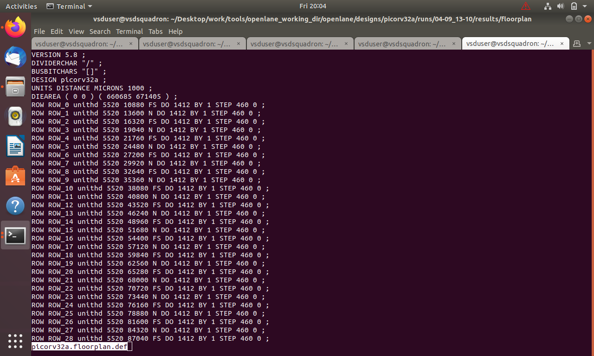</p>

The DEF evidence contains:

```text
VERSION 5.8 ;
DIVIDERCHAR "/" ;
BUSBITCHARS "[]" ;
DESIGN picorv32a ;
UNITS DISTANCE MICRONS 1000 ;
DIEAREA (0 0) (660685 671405) ;
```

The rows include entries such as:

```text
ROW ROW_0 ... FS DO 1412 BY 1 STEP 460 ...
ROW ROW_1 ... N DO 1412 BY 1 STEP 460 ...
```

## What DEF provides

DEF describes physical implementation information such as:

- die area
- rows
- components
- pins
- nets
- placement information

---

# 7. Experiment 5 — Placement Rows and Orientation

The DEF shows alternating row orientations:

```text
FS
N
FS
N
...
```

Alternating/mirrored rows are used so that standard-cell power connections align correctly across neighboring rows.

This is an important physical-design concept because standard-cell rows are not simply identical copies placed without orientation rules.

---

# 8. Experiment 6 — OpenROAD IO Placement

<p align="center">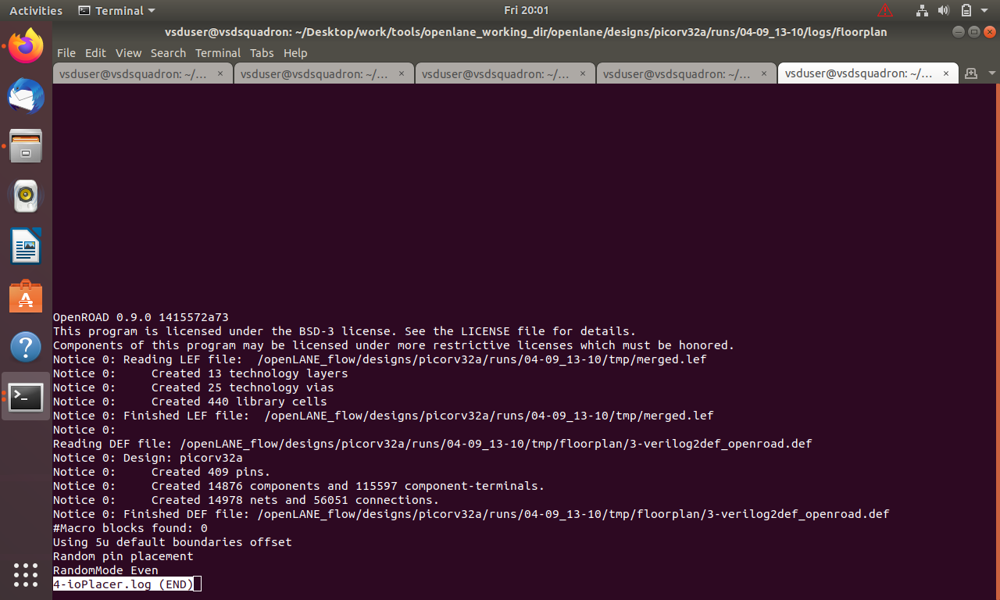</p>

The log reports:

```text
OpenROAD 0.9.0
Created 13 technology layers
Created 25 technology vias
Created 440 library cells
```

The design statistics shown include:

```text
Created 409 pins
Created 14876 components
Created 115597 component-terminals
Created 14978 nets
Created 56051 connections
```

The log also reports:

```text
Macro blocks found: 0
```

and shows random pin placement settings.

---

# 9. Experiment 7 — Understanding the IO Placer

IO placement determines where external design pins are physically located.

A simplified view is:

```text
             IO PINS
        +----------------+
        |                |
 IO --->|     CORE       |<--- IO
        |                |
        +----------------+
             IO PINS
```

Poor pin placement can increase:

- wirelength
- routing congestion
- timing delay

Therefore IO placement is an important physical optimization step.

---

# 10. Experiment 8 — Physical IO-Cell View

<p align="center">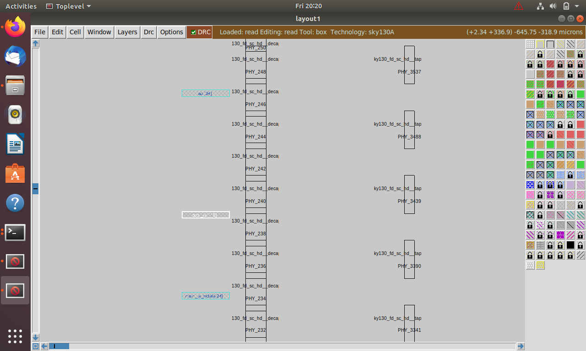</p>

The physical view shows geometry rather than RTL statements.

The designer can observe:

- physical cell shapes
- pins
- metal layers
- boundaries
- physical placement

This illustrates:

```text
Logical port
    ↓
Physical IO cell
    ↓
Physical pin
    ↓
Metal connection
```

---

# 11. Experiment 9 — Full Floorplan

<p align="center">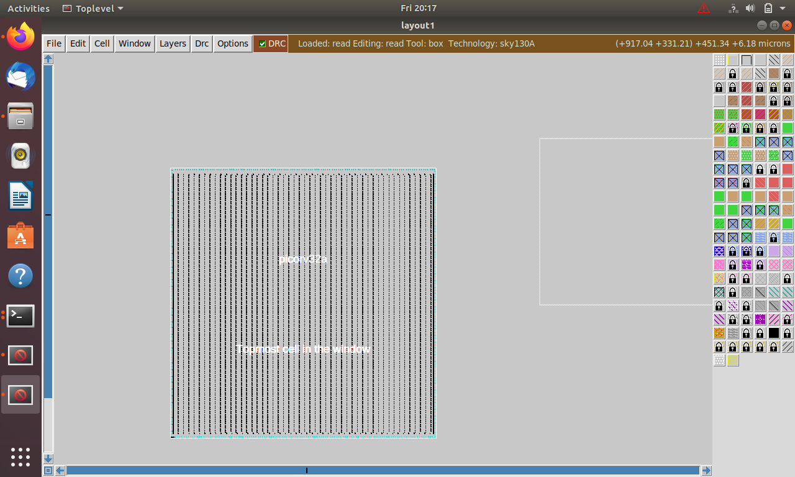</p>

The full floorplan view demonstrates the physical organization of the design.

Important regions include:

- die boundary
- core region
- IO region
- standard-cell rows
- power infrastructure

Floorplanning establishes the physical canvas required by later placement and routing stages.

---

# 12. Experiment 10 — Run Directory and Logs

<p align="center">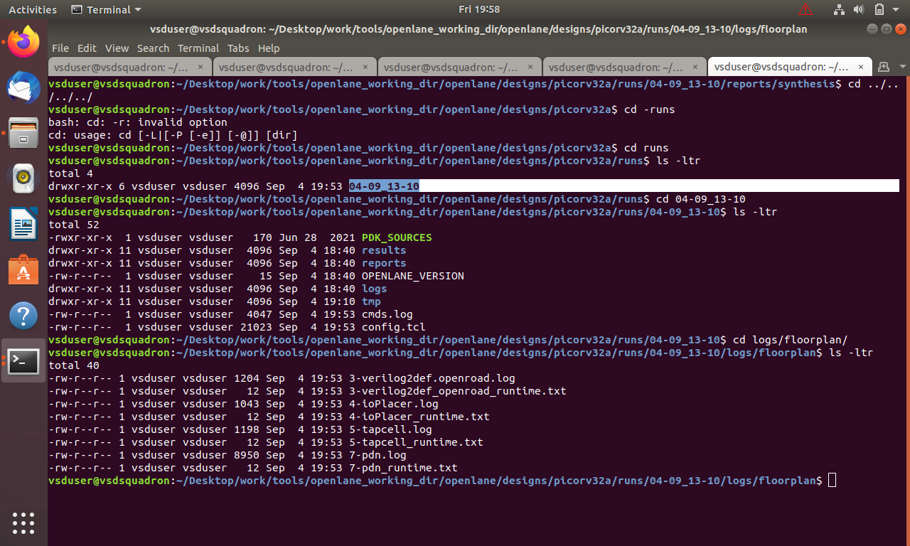</p>

The supplied run contains:

```text
runs/
└── 04-09_13-10/
    ├── PDK_SOURCES/
    ├── results/
    ├── reports/
    ├── OPENLANE_VERSION
    ├── logs/
    ├── tmp/
    ├── cmds.log
    └── config.tcl
```

Floorplan-related logs include:

```text
3-verilog2def.openroad.log
3-verilog2def_openroad_runtime.txt
4-ioPlacer.log
4-ioPlacer_runtime.txt
5-tapcell.log
5-tapcell_runtime.txt
7-pdn.log
7-pdn_runtime.txt
```

These logs are essential for physical-design debugging.

---

# 13. Experiment 11 — Placement Layout

<p align="center">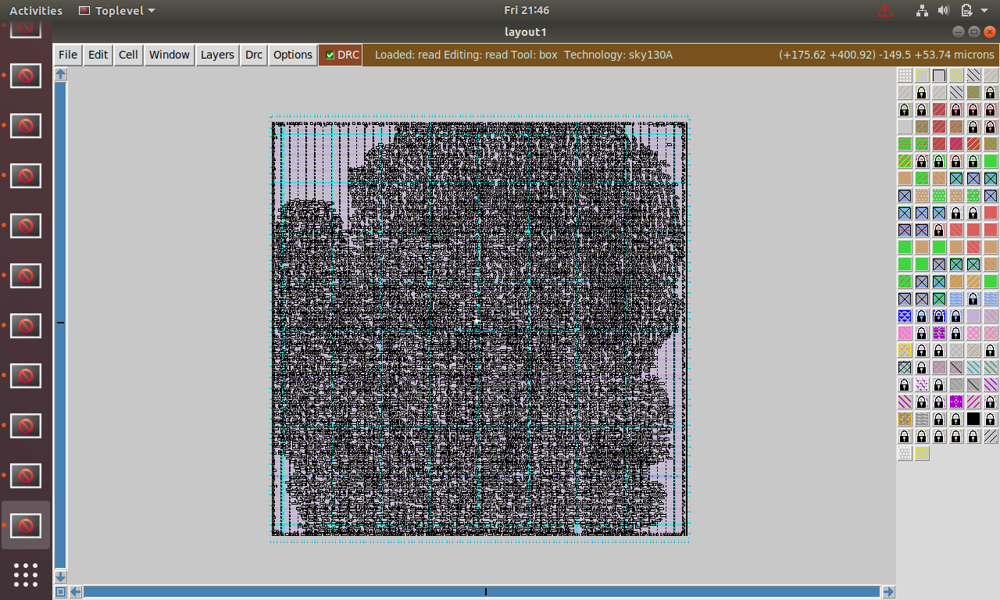</p>

Placement assigns physical coordinates to the technology-mapped standard cells.

The placer considers:

- connectivity
- density
- timing
- congestion
- legal placement
- available rows

The result is a physical arrangement that can be passed to CTS and routing.

---

# 14. Experiment 12 — Standard-Cell Placement

<p align="center">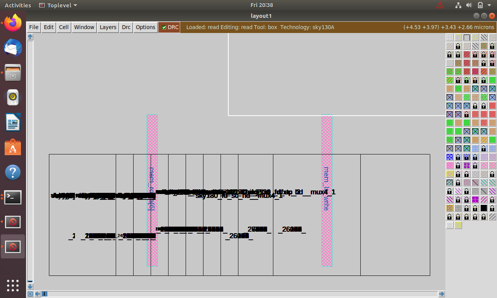</p>

The screenshot shows a dense standard-cell implementation.

Examples of Sky130 standard-cell types visible in the detailed evidence include:

```text
sky130_fd_sc_hd__dfxtp_4
sky130_fd_sc_hd__tapvpwrvgnd_1
```

Other logic cells include buffers, multiplexers and related standard cells.

---

# 15. Experiment 13 — Detailed Standard-Cell Placement

<p align="center">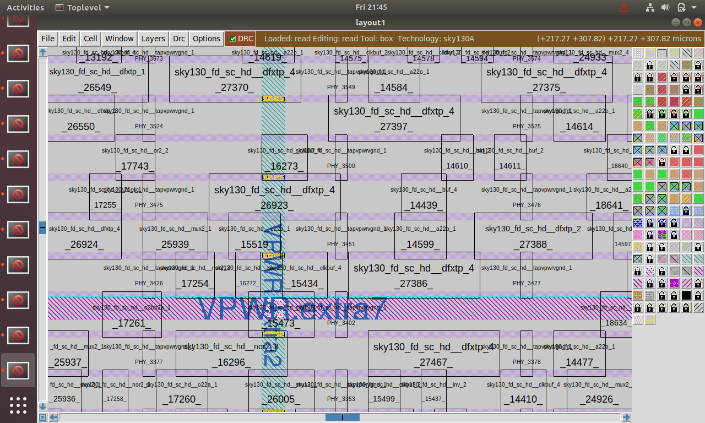</p>

The detailed view allows inspection of:

- cell boundaries
- standard-cell orientation
- tap cells
- placement rows
- local physical structures
- neighboring cells

This provides a direct view of the physical representation of the synthesized design.

---

# 16. Experiment 14 — OpenLane Configuration Reference

<p align="center">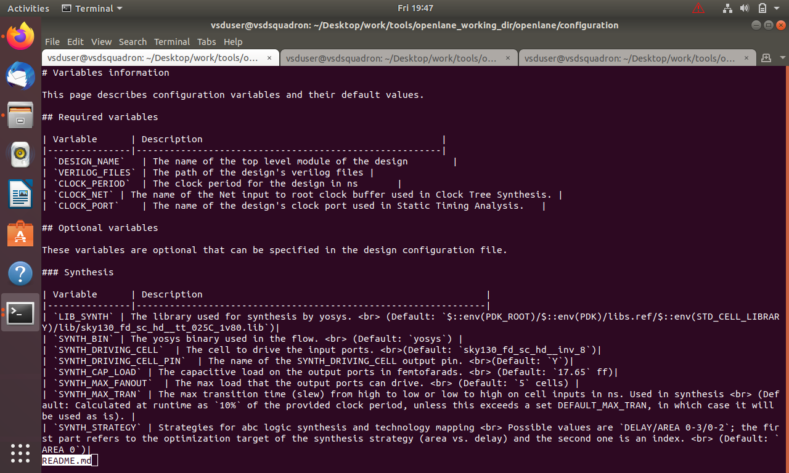</p>

The supplied reference lists important variables such as:

```text
DESIGN_NAME
VERILOG_FILES
CLOCK_PERIOD
CLOCK_NET
CLOCK_PORT
```

and synthesis-related variables:

```text
LIB_SYNTH
SYNTH_BIN
SYNTH_DRIVING_CELL
SYNTH_DRIVING_CELL_PIN
SYNTH_CAP_LOAD
SYNTH_MAX_FANOUT
SYNTH_MAX_TRAN
SYNTH_STRATEGY
```

These variables demonstrate how synthesis and physical implementation can be controlled through configuration.

---

# 17. Experiment 15 — Tap Cells

The run contains:

```text
5-tapcell.log
5-tapcell_runtime.txt
```

Tap cells provide technology-specific physical well/substrate connections.

They are physical-support cells rather than normal functional logic.

---

# 18. Experiment 16 — PDN Preparation

The run contains:

```text
7-pdn.log
7-pdn_runtime.txt
```

The PDN provides physical power paths for the placed design.

Conceptually:

```text
VDD
 |
 +---- power rails ----> standard cells
 |
VSS
 |
 +---- ground rails ---> standard cells
```

The PDN must be considered together with floorplan dimensions and standard-cell rows.

---

# 19. Experiment 17 — Placement Quality

Placement quality affects later stages.

Poor placement can cause:

- high wirelength
- congestion
- timing problems
- difficult CTS
- routing failures

Better placement aims to balance:

```text
Timing
+
Density
+
Wirelength
+
Congestion
+
Legal placement
```

---

# 20. Experiment 18 — From Placement to CTS

After placement, the clock network can be implemented.

```text
Clock source
      |
      v
Clock tree
    /   \
   v     v
  FF     FF
```

The runtime configuration already contains CTS-related settings, demonstrating that clock-tree implementation is part of the subsequent physical flow.

---

# 21. Experiment 19 — From CTS to Routing

The later physical flow is:

```text
Placement
   ↓
CTS
   ↓
Global Routing
   ↓
Detailed Routing
   ↓
Extraction
   ↓
STA
   ↓
Physical Sign-off
```

Routing creates the actual metal interconnections between the placed cells and IOs.

---

# 22. Important Commands

Typical classic OpenLane interactive entry:

```bash
./flow.tcl -interactive
```

Prepare the design:

```tcl
prep -design picorv32a
```

Typical stages:

```tcl
run_synthesis
run_floorplan
run_placement
gen_pdn
```

Inspect runs:

```bash
cd runs
ls
cd 04-09_13-10
ls
```

Inspect logs:

```bash
cd logs
ls
```

Exact commands depend on the OpenLane version used.

---

# 23. Observations

1. PicoRV32A is the physical-design target.
2. `clk` is the clock port.
3. The design configuration shows a 5.000 clock-period value.
4. The runtime configuration contains a different resolved clock-period value of 24.73.
5. Core utilization is configured to 50.
6. The target aspect ratio is 1.
7. IO metal layers are explicitly configured.
8. PDN pitch and offset are explicitly configured.
9. The DEF contains a physical die boundary.
10. Standard-cell rows are defined in DEF.
11. Alternating row orientations are visible.
12. The IO placer reports 409 pins.
13. The IO placer reports 14876 components.
14. The IO placer reports 14978 nets.
15. No macro blocks are reported in the shown IO-placement stage.
16. Standard-cell placement is visible at both full and detailed scales.
17. Tap-cell and PDN logs are present in the run.

---

# 24. Results

The evidence demonstrates:

- OpenLane physical-design configuration
- floorplan configuration
- DEF generation/inspection
- IO placement
- physical IO-cell organization
- floorplan visualization
- standard-cell placement
- detailed cell-level layout
- tap-cell processing
- PDN preparation
- run-directory/log organization

---

# 25. Key Concepts Learned

### Floorplanning

Defines the physical canvas.

### IO Placement

Places external pins.

### DEF

Describes physical design information.

### Standard-Cell Rows

Provide legal cell-placement locations.

### PDN

Distributes VDD and VSS.

### Tap Cells

Provide technology-required substrate/well connections.

### Placement

Assigns physical locations to standard cells.

### CTS

Builds the clock network.

### Routing

Creates physical metal interconnect.

---

# 26. Complete Physical-Design Flow

```text
RTL
 ↓
Synthesis
 ↓
Netlist
 ↓
Floorplan
 ↓
IO Placement
 ↓
Tap Cells
 ↓
PDN
 ↓
Standard-Cell Placement
 ↓
CTS
 ↓
Routing
 ↓
Extraction
 ↓
STA
 ↓
DRC / LVS / Sign-off
 ↓
GDSII
```

Module 6 establishes the synthesis/technology/timing foundation.

Module 7 continues with the physical implementation.

---

# 27. Evidence Integrity

Only the supplied Module 7 screenshots are claimed as evidence here.

No final GDSII, SPEF, final routed DEF, DRC or LVS result is claimed unless separately provided.

---

# 28. Conclusion

Module 7 demonstrates the transition from the synthesized PicoRV32A design into physical implementation.

The work covers floorplan configuration, DEF representation, IO placement, physical IO cells, tap cells, PDN preparation and standard-cell placement.

The key lesson is that physical design is an interconnected optimization problem:

```text
Floorplan
   ↓
IO placement
   ↓
PDN
   ↓
Placement
   ↓
CTS
   ↓
Routing
   ↓
Sign-off
```

The physical decisions made in Module 7 form the foundation for the later CTS, routing and sign-off stages.
