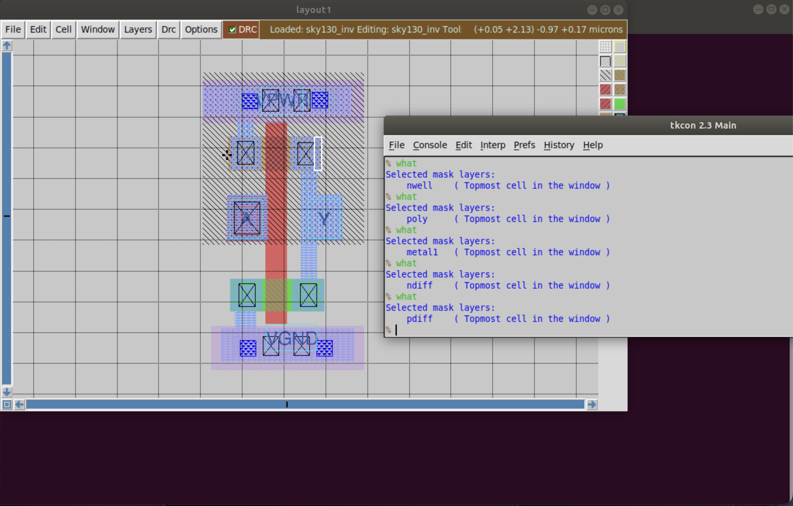
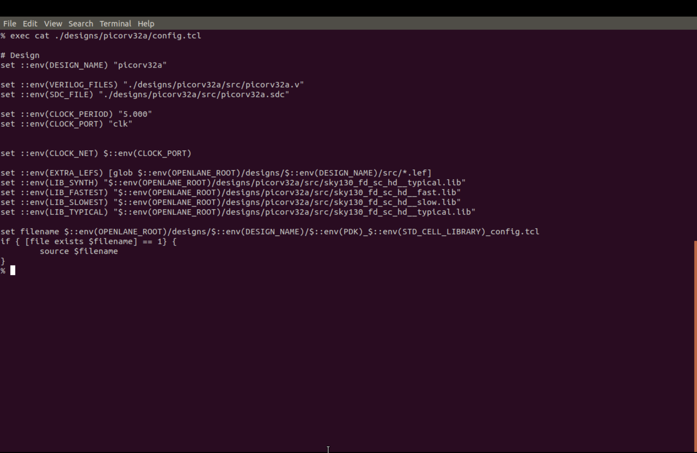
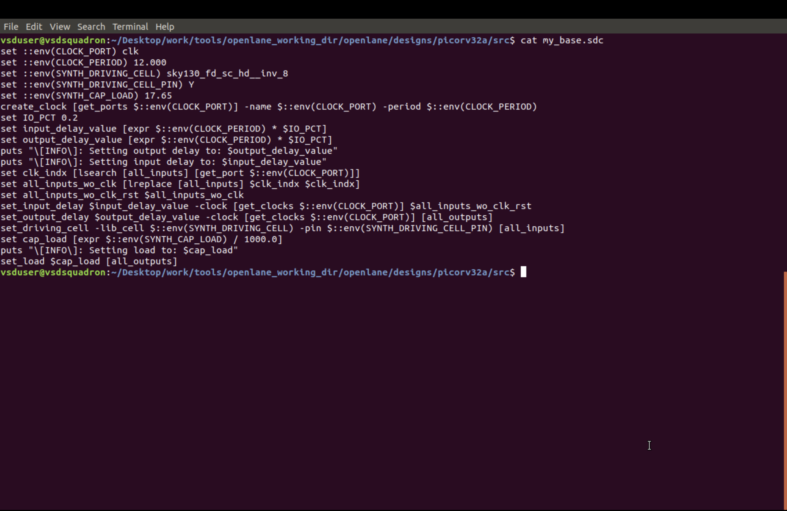
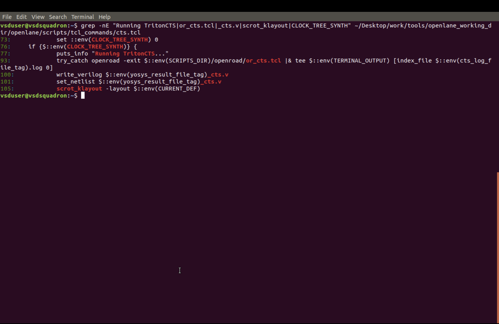
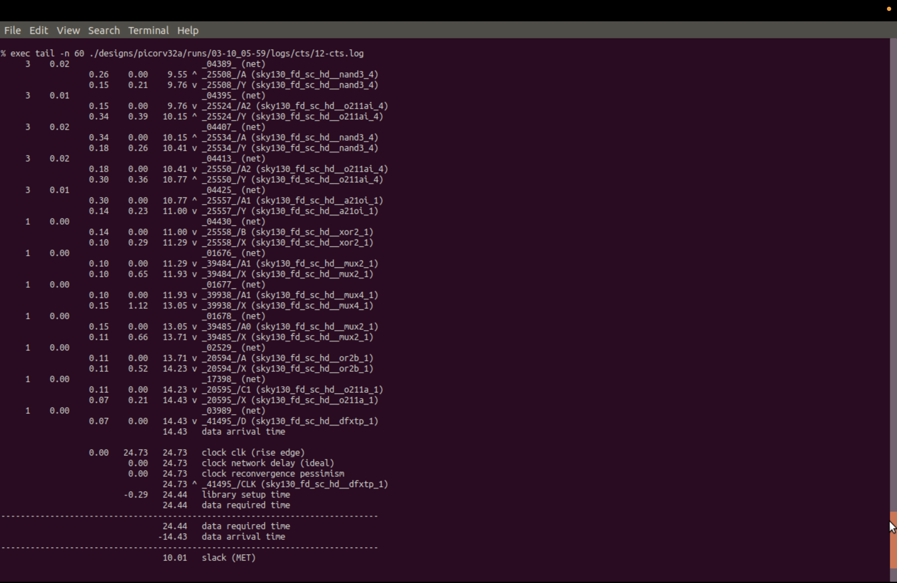
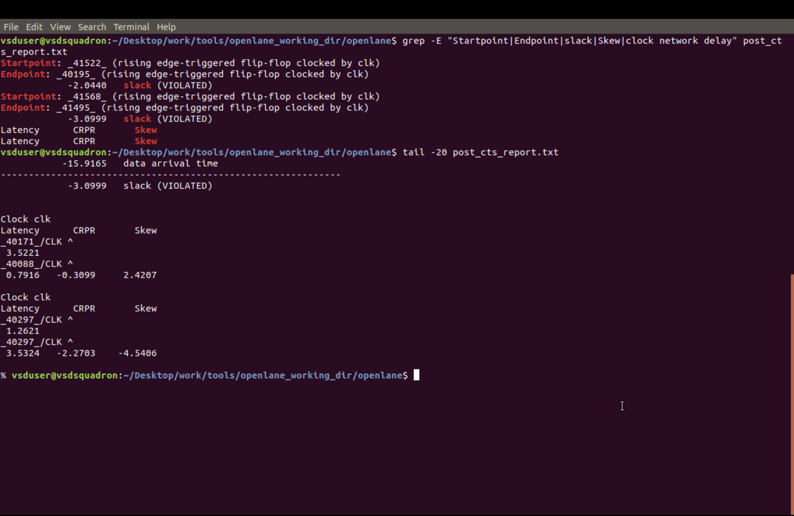
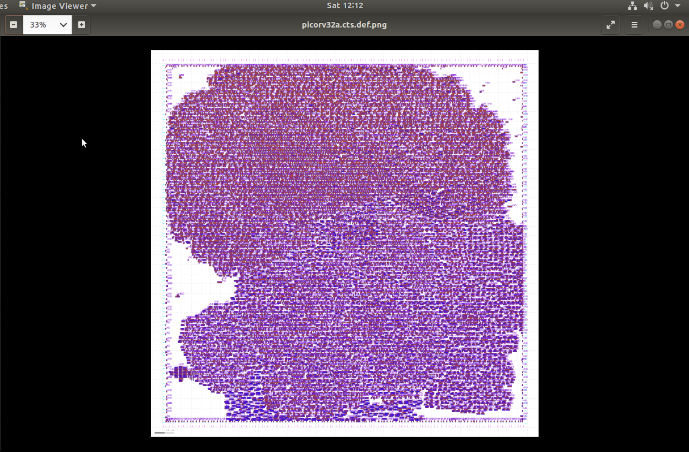

# Module 9: SKY130 VLSI Design — Synthesis, Floorplanning and Clock Timing Analysis

## Introduction

This module covers custom-cell integration, synthesis optimization, floorplanning, standard-cell placement, clock-tree synthesis (CTS), and static timing analysis (STA) for the Sky130 `picorv32a` design.

The workflow begins with a custom CMOS inverter and its physical library abstract. The inverter's library information is integrated into OpenLane, followed by synthesis timing analysis, floorplanning, placement, and clock-network evaluation.

The screenshots below document the major design stages and their corresponding outputs.

## Objectives

- Inspect a custom CMOS inverter layout using Magic.
- Understand LEF and Liberty library integration.
- Compare synthesis statistics before and after timing optimization.
- Analyze critical timing paths using OpenSTA.
- Understand floorplanning and placement statistics.
- Study clock-tree synthesis and clock distribution.
- Analyze timing slack and clock skew.
- Review post-CTS timing results.

## Tools and Technologies

- SkyWater SKY130 PDK
- Magic VLSI Layout
- OpenLane
- OpenROAD
- Yosys
- OpenSTA
- LEF, Liberty and SDC files

---

## 1. Custom Inverter Layout and Library Integration

### 1. `custom_inverter_layout_check.png` — Custom Inverter Layout

This output shows the custom CMOS inverter layout inspected using Magic. The layout represents the transistor structures, interconnections, and physical layers used to implement the inverter.

The inspection helps verify the cell geometry before its physical abstract is generated.



### 2. `sky130_inverter_lef_abstract.png` — Sky130 Inverter LEF Abstract

The Library Exchange Format (LEF) describes the physical information required by placement and routing tools, including cell dimensions and pin geometry.

This output shows the physical abstract of the custom inverter used in the implementation flow.


### 3. `openlane_design_configuration.png` — OpenLane Design Configuration

OpenLane configuration settings define the design inputs, clock settings, and implementation options.

This screenshot documents the initial configuration for the `picorv32a` design before additional custom-cell library settings are applied.


### 4. `technology_lef_lib_configuration.png` — Technology LEF and Liberty Configuration

LEF files provide physical cell information, while Liberty files provide cell functionality and timing models.

This output shows the configuration of additional physical and timing libraries used by the design flow.



---

## 2. Synthesis and Timing Analysis

### 5. `synthesis_statistics_before_timing_fixes.png` — Baseline Synthesis Statistics

Logic synthesis converts the design into a network of technology-specific standard cells.

The recorded baseline results are:

- Chip area: `147712.9184`
- Worst Negative Slack (WNS): `-24.89`
- Total Negative Slack (TNS): `-759.46`

The negative slack indicates that the reported timing requirements are not met for the corresponding paths.


### 6. `opensta_static_timing_report.png` — Critical-Path Timing Report

Static Timing Analysis evaluates path delays against the specified timing constraints.

This output shows the critical maximum-delay path report generated using OpenSTA. The report identifies the path startpoint, endpoint, path group, and delay contributions.

The critical-path analysis helps identify logic that contributes to timing violations.


### 7. `synthesis_statistics_after_timing_fixes.png` — Timing-Optimized Synthesis

Timing-oriented synthesis can change logic mapping, buffering, and cell sizing to improve timing performance.

The recorded settings are:

```tcl
SYNTH_STRATEGY "DELAY 0"
SYNTH_BUFFERING 1
SYNTH_SIZING 1
```

The recorded optimized results are:

- Chip area: `196832.528`
- WNS: `0.00`
- TNS: `0.00`

The comparison demonstrates the recorded timing improvement and the associated increase in area.


### 8. `abc_mapped_synthesis_statistics.png` — ABC Technology Mapping

ABC technology mapping converts the optimized logic network into cells from the target technology library.

This output shows the mapped-cell statistics, including standard-cell types and counts. It helps explain the composition of the synthesized netlist.


---

## 3. Floorplanning and Standard-Cell Placement

### 9. `floorplan_die_and_core_area.png` — Floorplan Die and Core Area

Floorplanning establishes the physical boundaries of the chip and the core region used for standard-cell placement.

The recorded dimensions are:

- Die boundary: `(0.0, 0.0)` to `(746.915, 757.635)` microns.
- Core boundary: `(5.52, 10.88)` to `(741.06, 745.28)` microns.

These dimensions describe the floorplan recorded during the implementation flow.


### 10. `placement_design_statistics.png` — Placement Design Statistics

Placement assigns physical locations to standard cells while considering utilization, legalization, and physical constraints.

The recorded placement statistics include:

- Instances: `18,673`
- Nets: `20,721`
- Utilization: `41%`
- Padded utilization: `58%`
- Rows: `270`

These values describe the recorded placement result.


### 11. `picorv32a_placement_layout.png` — PICORV32A Placement Layout

This output provides a visual representation of the placed `picorv32a` standard cells. It complements the numerical placement statistics by showing the physical arrangement of the design within the core.


---

## 4. Timing Constraints and Clock-Tree Synthesis

### 12. `base_timing_constraints_sdc.png` — Base Timing Constraints

Static timing analysis depends on the timing constraints defined for the design. An SDC file can specify clock periods, input and output delays, and clock uncertainty.

This screenshot documents the base timing-constraint information associated with the implementation flow.



### 13. `clock_tree_synthesis_run_settings.png` — Clock-Tree Synthesis Execution

Clock-tree synthesis generates a physical clock distribution network for sequential elements. It inserts clock buffers and attempts to control differences in clock arrival times.

This output documents the CTS command execution and associated tool output.



### 14. `clock_tree_synthesis_timing_slack.png` — Clock-Tree Synthesis Timing Slack

Timing slack indicates the margin between the actual signal arrival time and the required arrival time under the report's timing convention.

This output records timing slack associated with the CTS stage. The report helps evaluate timing behavior after clock-tree insertion.



### 15. `clock_tree_synthesis_skew_report.png` — Clock Skew Analysis

Clock skew is the difference in clock arrival time between sequential elements. It can influence setup and hold timing.

This output documents the clock-skew analysis for the generated clock network and helps evaluate clock distribution behavior.


### 16. `post_cts_real_clock_timing_analysis.png` — Post-CTS Real-Clock Timing Analysis

After clock-tree synthesis, timing analysis evaluates the design using the generated clock network rather than relying solely on an ideal-clock model.

This output records the post-CTS timing analysis. The report should be examined for timing slack and remaining setup or hold violations.



### 17. `triton_cts_statistics.png` — TritonCTS Statistics

TritonCTS is the clock-tree synthesis engine used in the OpenROAD ecosystem.

This output records statistics associated with the generated clock network and provides information about the CTS implementation.


### 18. `picorv32_clock_tree_synthesis_def.png` — PICORV32 Clock-Tree Synthesis Design

This output shows the physical design representation at the clock-tree synthesis stage. It can be compared with the placement layout to understand the design after clock-tree insertion.

The image documents the captured CTS-stage physical design, but does not by itself establish that detailed routing or final sign-off is complete.



---

## 5. Overall Design Workflow

The module follows this general sequence:

1. Custom inverter layout inspection using Magic.
2. LEF abstract generation.
3. OpenLane physical and timing library configuration.
4. Logic synthesis and technology mapping.
5. Critical-path timing analysis.
6. Timing-oriented synthesis optimization.
7. Floorplanning and standard-cell placement.
8. Timing-constraint review.
9. Clock-tree synthesis.
10. Clock skew and timing slack analysis.
11. Post-CTS timing verification.

## 6. Results and Discussion

The synthesis reports document the recorded timing improvement after timing-oriented optimization, accompanied by an increase in reported area.

The floorplanning and placement outputs describe the physical dimensions and organization of the `picorv32a` design. The CTS reports provide evidence for examining clock distribution, timing slack, and clock skew.

Post-CTS timing analysis is important because clock insertion delay and skew can affect the timing relationship between sequential elements.

The recorded results describe the captured stages of the flow. Complete timing closure requires verification of the applicable setup and hold paths, routing parasitics, and required process-voltage-temperature corners.

## 7. Limitations

- Synthesis timing results do not guarantee timing closure after CTS or routing.
- Library configuration does not prove that synthesis selected the custom inverter.
- Placement and CTS screenshots alone do not establish complete setup and hold timing closure.
- Final routed timing and sign-off verification are not established by these screenshots alone.
- Numerical results should be interpreted using the original reports, units, and constraints.

## 8. Conclusion

This module demonstrates important stages of Sky130-based VLSI implementation, including custom-cell integration, synthesis optimization, floorplanning, placement, clock-tree synthesis, and static timing analysis.

The embedded outputs provide visual evidence of the captured design stages and help explain the relationship between logic synthesis, physical organization, clock distribution, and timing performance.

## Student Details

- **Name:** R. Lingaswamy
- **Roll Number:** 25EG504E01

