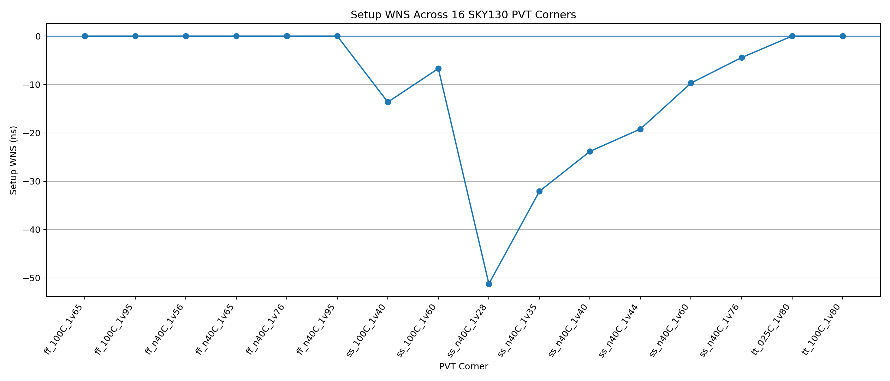
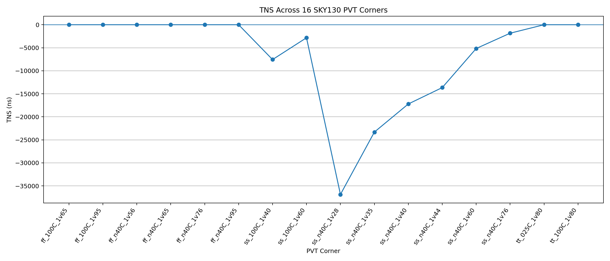
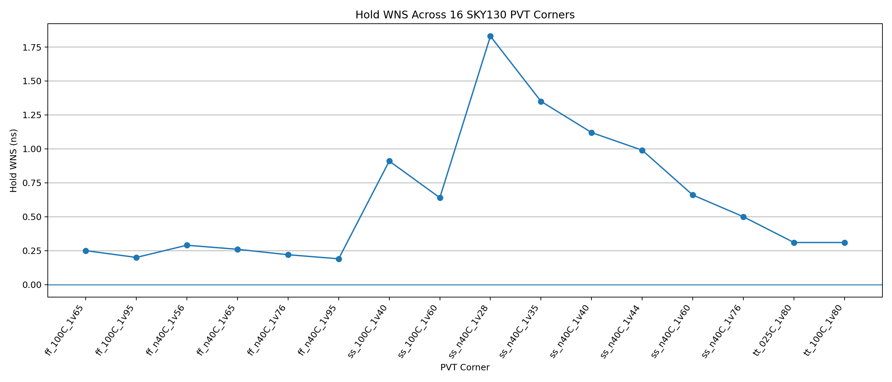

# VSDBabySoC Static Timing Analysis (STA)

## Overview

This repository contains terminal screenshots, the complete 16-corner STA results table, a CSV copy of the table, and graphs generated from the reported timing values.

- **Design:** VSDBabySoC
- **STA tool:** OpenSTA 2.3.0
- **Timing libraries/platform:** SKY130
- **Clock:** `clk`, 11.00 ns
- **Normal PVT corners:** 16

## Complete 16-Corner Summary

| Corner | Process | Temp (°C) | Voltage (V) | Hold WNS (ns) | Setup WNS (ns) | TNS (ns) | Setup |
|---|---|---:|---:|---:|---:|---:|---|
| `ff_100C_1v65` | FF | 100 | 1.65 | +0.25 | +0.00 | +0.00 | MET |
| `ff_100C_1v95` | FF | 100 | 1.95 | +0.20 | +0.00 | +0.00 | MET |
| `ff_n40C_1v56` | FF | -40 | 1.56 | +0.29 | +0.00 | +0.00 | MET |
| `ff_n40C_1v65` | FF | -40 | 1.65 | +0.26 | +0.00 | +0.00 | MET |
| `ff_n40C_1v76` | FF | -40 | 1.76 | +0.22 | +0.00 | +0.00 | MET |
| `ff_n40C_1v95` | FF | -40 | 1.95 | +0.19 | +0.00 | +0.00 | MET |
| `ss_100C_1v40` | SS | 100 | 1.40 | +0.91 | -13.64 | -7567.79 | VIOLATED |
| `ss_100C_1v60` | SS | 100 | 1.60 | +0.64 | -6.71 | -2833.05 | VIOLATED |
| `ss_n40C_1v28` | SS | -40 | 1.28 | +1.83 | -51.21 | -36861.42 | VIOLATED |
| `ss_n40C_1v35` | SS | -40 | 1.35 | +1.35 | -32.09 | -23317.56 | VIOLATED |
| `ss_n40C_1v40` | SS | -40 | 1.40 | +1.12 | -23.83 | -17211.28 | VIOLATED |
| `ss_n40C_1v44` | SS | -40 | 1.44 | +0.99 | -19.20 | -13652.10 | VIOLATED |
| `ss_n40C_1v60` | SS | -40 | 1.60 | +0.66 | -9.71 | -5165.98 | VIOLATED |
| `ss_n40C_1v76` | SS | -40 | 1.76 | +0.50 | -4.45 | -1842.56 | VIOLATED |
| `tt_025C_1v80` | TT | 25 | 1.80 | +0.31 | +0.00 | +0.00 | MET |
| `tt_100C_1v80` | TT | 100 | 1.80 | +0.31 | +0.00 | +0.00 | MET |

## Graphs

### Setup WNS

### Total Negative Slack (TNS)

### Hold WNS

## Key Findings

- The worst reported setup corner is `ss_n40C_1v28` (SS, -40°C, 1.28 V).
- At this corner, setup WNS is **-51.21 ns**, TNS is **-36861.42 ns**, and hold WNS is **+1.83 ns**.
- All six FF rows and both TT rows have non-negative setup WNS in the reported table.
- All eight SS rows have negative setup WNS.
- Hold WNS is positive for all 16 corners in the reported summary.

## Important Note About the TT Reference Value

The 16-corner table records setup WNS as `+0.00 ns` for both TT rows. However, the separate TT Reference Timing Check section of the supplied PDF reports setup WNS of **+0.86 ns** for `tt_025C_1v80`, with hold WNS of **+0.31 ns**. The table and graphs preserve the 16-corner table values. Check the original OpenSTA log to determine the authoritative value.

## Repository Files

- `STA_16_Corner_Summary.csv` — machine-readable timing summary.
- `graphs/Setup_WNS_16_Corners.png` — setup slack graph.
- `graphs/TNS_16_Corners.png` — total negative slack graph.
- `graphs/Hold_WNS_16_Corners.png` — hold slack graph.
- `README.md` — project overview, results table, and graphs.
- Root-level PNG screenshots — terminal execution evidence.

## Scope and Reproducibility

The numerical values are transcribed from the supplied PDF. The graphs are generated from its 16-corner summary table; they are not fresh STA runs. The screenshot package does not necessarily include the synthesized netlist, SDC, timing libraries, or scripts required to reproduce the analysis.

