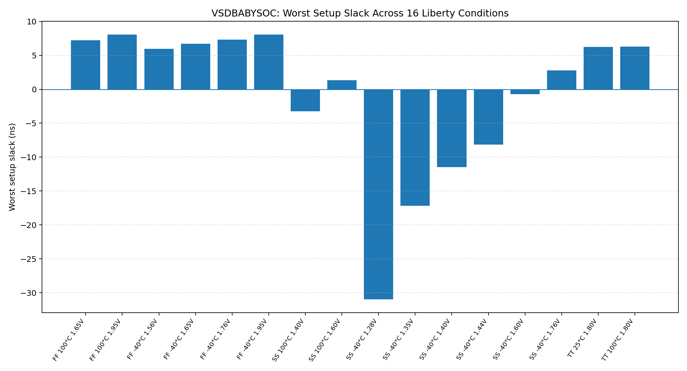
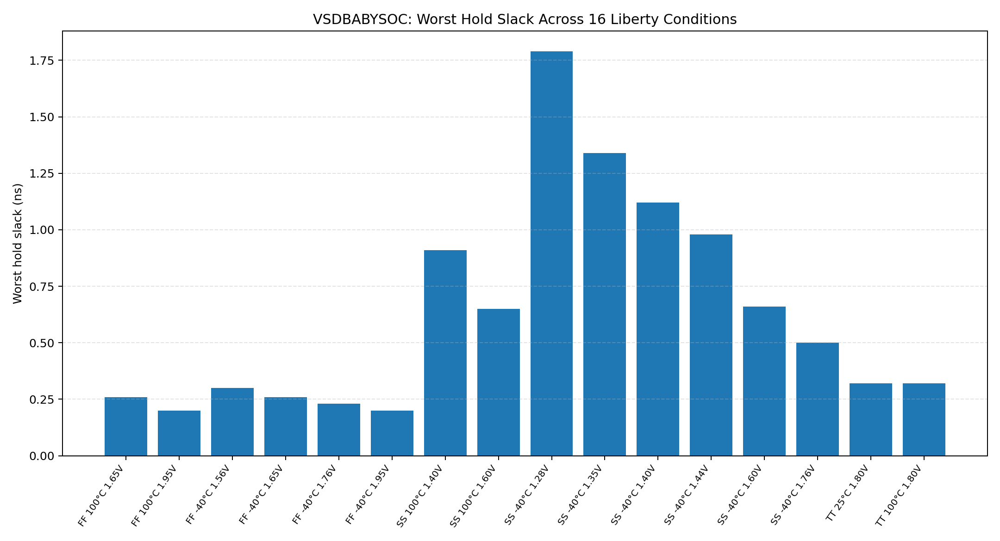
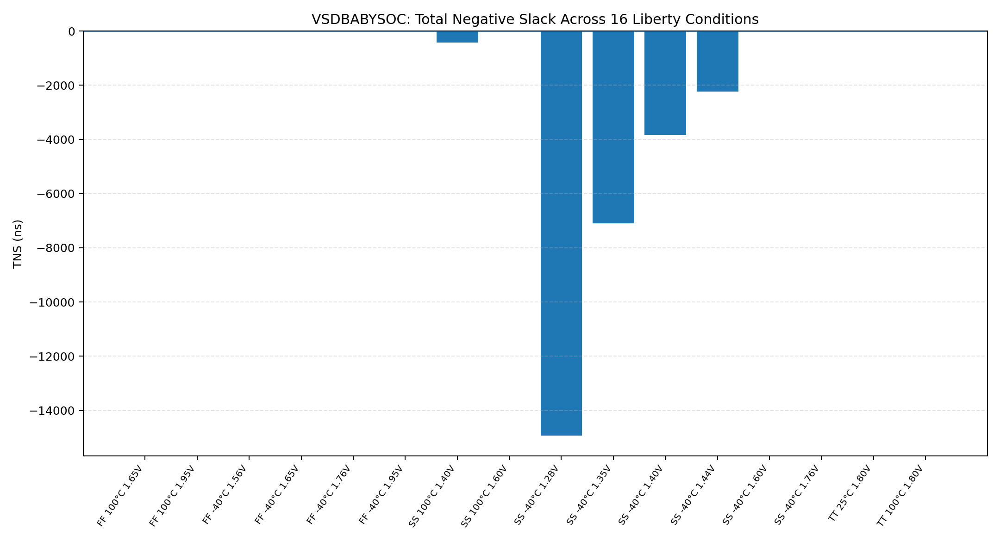
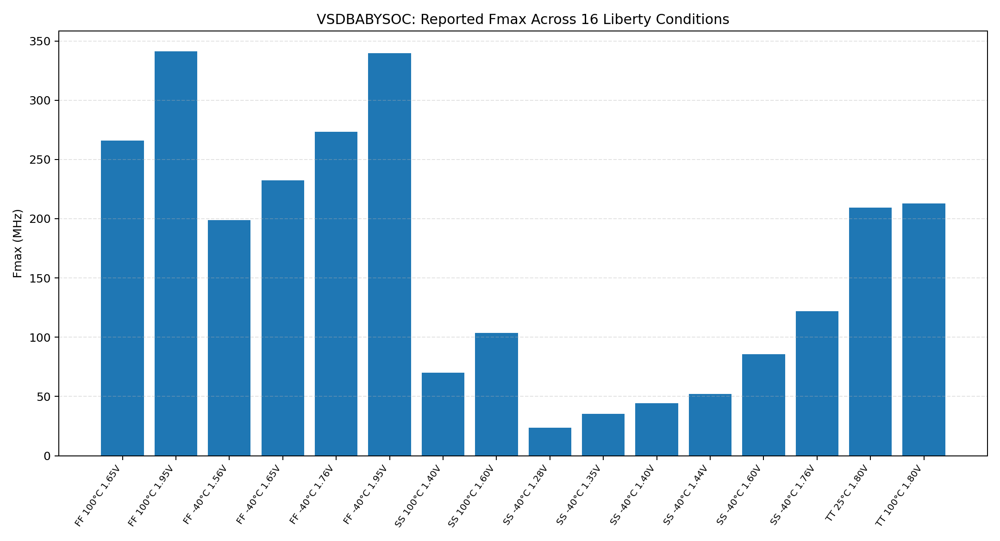

# VSDBABYSOC Post-Route Static Timing Analysis (STA)

**Student Name:** R. Lingaswamy  
**Design:** VSDBABYSOC  
**Technology:** SkyWater SKY130HD  
**Tools:** OpenROAD-flow-scripts, OpenROAD GUI, OpenSTA  
**Analysis:** Post-route static timing analysis across 16 Liberty timing conditions  
**Parasitics referenced:** `6_final.spef`

---

## 1. Project Overview

This repository documents post-route Static Timing Analysis (STA) for the VSDBABYSOC design using the SKY130HD standard-cell technology. The supplied timing reports were reviewed across 16 process-voltage-temperature (PVT) Liberty conditions. The repository includes the original per-condition STA reports, Tcl scripts, logs, a summary file, physical-design screenshots, and graphs generated from the values in that summary.

STA checks whether signal paths meet timing requirements without requiring dynamic simulation of every possible input sequence. Setup analysis checks whether data arrives early enough before a capturing clock edge. Hold analysis checks whether data remains stable long enough after the clock edge.

## 2. Repository Structure

```text
VSDBABYSOC-Post-Route-STA/
├── README.md
├── graphs/
│   ├── setup_slack_16_conditions.png
│   ├── hold_slack_16_conditions.png
│   ├── tns_16_conditions.png
│   └── fmax_16_conditions.png
├── reports/
│   └── sky130hd/
│       └── vsdbabysoc/
│           └── base/
│               └── sta16/
│                   ├── STA_16_CORNERS_SUMMARY.txt
│                   ├── sta_*.rpt
│                   ├── sta_*.tcl
│                   └── *.log
└── screenshots/
    ├── floorplan(4).png
    ├── place(2).png
    ├── place1(2).png
    ├── place_gui(2).png
    ├── cts(1).png
    ├── cts1(2).png
    ├── routing(3).png
    ├── ff_cornerreport(2).png
    ├── ss_1report(3).png
    ├── ss_2report(3).png
    ├── ss_3report(3).png
    └── tt_*cornerreport(2).png
```

The original STA artifact filenames and relative paths are preserved. Temporary Vim swap files are excluded because they are editor-generated temporary files.

## 3. Physical Design Flow

The screenshots below show selected physical-design stages supplied with this project. They are visual evidence from the supplied screenshots, not newly regenerated tool views.

### 3.1 Floorplanning

Floorplanning defines the core and die region, placement rows, and initial space for the design.

.png)

### 3.2 Placement

Placement assigns standard cells to legal locations within the floorplan. Placement quality affects wire length, congestion, and timing.

.png)

The additional placement screenshots provide other views of the placement stage:

.png)

.png)

### 3.3 Clock-Tree Synthesis (CTS)

CTS builds the clock distribution network and inserts clock buffers to distribute the clock to sequential elements. Clock latency and skew influence setup and hold timing.

.png)

.png)

### 3.4 Routing

Routing connects the placed cells using the available metal layers and vias. The routed interconnect contributes parasitic resistance and capacitance, which affect signal delay.

.png)

## 4. STA Methodology and Included Files

The per-condition artifacts are stored in:

`reports/sky130hd/vsdbabysoc/base/sta16/`

- `STA_16_CORNERS_SUMMARY.txt` — compact summary of the 16 reported Liberty conditions.
- `sta_*.rpt` — detailed timing reports, including timing paths and slack.
- `sta_*.tcl` — scripts associated with the individual STA conditions.
- `*.log` — captured run output for the relevant conditions.

The analysis references the routed parasitic file `6_final.spef`. The individual report files should be consulted for the full path-level details and the corresponding condition.

## 5. Results Across 16 Liberty Conditions

The table below reproduces the values in the supplied `STA_16_CORNERS_SUMMARY.txt`. Slack values are in nanoseconds, minimum period is in nanoseconds, and Fmax is in megahertz.

| Liberty condition | Worst setup slack (ns) | Worst hold slack (ns) | TNS (ns) | Minimum period (ns) | Fmax (MHz) |
|---|---:|---:|---:|---:|---:|
| FF, 100 °C, 1.65 V | 7.24 | 0.26 | 0.00 | 3.76 | 266.02 |
| FF, 100 °C, 1.95 V | 8.07 | 0.20 | 0.00 | 2.93 | 341.26 |
| FF, -40 °C, 1.56 V | 5.97 | 0.30 | 0.00 | 5.03 | 198.81 |
| FF, -40 °C, 1.65 V | 6.70 | 0.26 | 0.00 | 4.30 | 232.55 |
| FF, -40 °C, 1.76 V | 7.34 | 0.23 | 0.00 | 3.66 | 273.27 |
| FF, -40 °C, 1.95 V | 8.06 | 0.20 | 0.00 | 2.94 | 339.58 |
| SS, 100 °C, 1.40 V | -3.27 | 0.91 | -427.07 | 14.27 | 70.06 |
| SS, 100 °C, 1.60 V | 1.35 | 0.65 | 0.00 | 9.65 | 103.65 |
| SS, -40 °C, 1.28 V | -30.97 | 1.79 | -14927.87 | 41.97 | 23.82 |
| SS, -40 °C, 1.35 V | -17.18 | 1.34 | -7092.53 | 28.18 | 35.49 |
| SS, -40 °C, 1.40 V | -11.49 | 1.12 | -3828.66 | 22.49 | 44.47 |
| SS, -40 °C, 1.44 V | -8.18 | 0.98 | -2238.06 | 19.18 | 52.15 |
| SS, -40 °C, 1.60 V | -0.70 | 0.66 | -7.09 | 11.70 | 85.49 |
| SS, -40 °C, 1.76 V | 2.80 | 0.50 | 0.00 | 8.20 | 121.91 |
| TT, 25 °C, 1.80 V | 6.23 | 0.32 | 0.00 | 4.77 | 209.43 |
| TT, 100 °C, 1.80 V | 6.30 | 0.32 | 0.00 | 4.70 | 212.98 |

## 6. Graphical Analysis

These graphs are generated from the numerical values in the supplied summary file. They are not separate timing-tool runs.

### 6.1 Worst Setup Slack

Positive setup slack indicates margin against the reported setup requirement; negative slack indicates a setup timing violation for that condition.



### 6.2 Worst Hold Slack

The reported worst hold slack is positive for every condition in this summary.



### 6.3 Total Negative Slack (TNS)

Non-zero negative TNS appears in the same six conditions that report negative setup slack. The large negative values at slow-slow (SS) conditions indicate substantial setup timing problems in those reported runs.



### 6.4 Reported Maximum Frequency (Fmax)

Fmax is reproduced from the supplied summary. The reported values are condition-specific and should not be interpreted as proof that the entire design closes timing at that frequency under all conditions.



## 7. Main Findings

1. The supplied summary contains **16 Liberty timing conditions**.
2. **Six conditions have negative worst setup slack**: SS at 100 °C / 1.40 V and SS at -40 °C / 1.28 V, 1.35 V, 1.40 V, 1.44 V, and 1.60 V.
3. The worst reported setup slack is **-30.97 ns** at SS, -40 °C, 1.28 V.
4. All 16 reported worst hold slack values are positive. The smallest reported hold slack is **+0.20 ns**.
5. The summary reports non-zero TNS for the six conditions with negative setup slack.
6. Based on these results, **setup timing closure is not achieved across all 16 reported conditions**.

### Interpretation caution

The supplied summary says the analysis uses `6_final.spef`. The available artifacts therefore support comparing 16 Liberty timing conditions using that referenced parasitic file; they do **not** by themselves prove that 16 independently extracted RC parasitic corners were analysed. Use this qualification in the final report or presentation.

## 8. Selected STA Report Screenshots

The following screenshots are grouped here as supporting report evidence. For exact numerical values and detailed timing paths, use the corresponding text reports in `reports/sky130hd/vsdbabysoc/base/sta16/`.

### 8.1 Fast-Fast (FF) condition

.png)

### 8.2 Slow-Slow (SS) condition examples

.png)

.png)

.png)

### 8.3 Typical-Typical (TT) condition examples

.png)

.png)

.png)

.png)

## 9. Reproducibility Notes

This repository contains the supplied analysis outputs and associated evidence. A full rerun may additionally require the matching OpenROAD-flow-scripts checkout, routed database `6_final.odb`, constraints `6_final.sdc`, the referenced `6_final.spef`, compatible SKY130HD Liberty and PDK files, and compatible versions of OpenROAD/OpenSTA. Do not assume these dependencies are included merely because timing reports and scripts are present.

## 10. Suggested Review Order

1. Read `reports/sky130hd/vsdbabysoc/base/sta16/STA_16_CORNERS_SUMMARY.txt`.
2. Review the four graphs under `graphs/` for an overview of setup slack, hold slack, TNS, and Fmax.
3. Open individual `sta_*.rpt` files to inspect detailed timing paths.
4. Inspect the physical-design screenshots in `screenshots/`.
5. Use the associated `sta_*.tcl` and `.log` files when investigating how an individual condition was evaluated.

## 11. Author

**R. Lingaswamy**  

---

